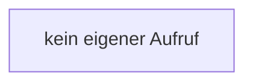

[[00 Start]] › [[Server-Anlage]] › [[Startplan]] › [[PropertiesFile]] › [[PropertiesFile.PropertiesFile]]

# PropertiesFile.PropertiesFile

`PropertiesFile.PropertiesFile()` [src/main/java/de/aichele/childlauncher/PropertiesFile.java:17–17](https://github.com/Sciddie/minecraft-serverhoster-plugin/blob/95b02b953b0b4c23673e900e021a7c3c844aa37d/src/main/java/de/aichele/childlauncher/PropertiesFile.java#L17-L17)

- `PropertiesFile` in `src/main/java/de/aichele/childlauncher/PropertiesFile.java`
