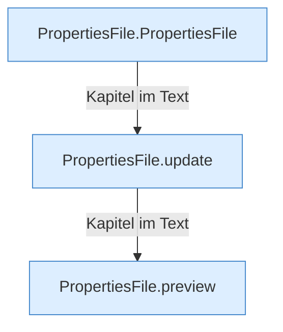

[[00 Start]] › [[Server-Anlage]] › [[Startplan]] › [[PropertiesFile]]

# PropertiesFile



```knoten
PropertiesFile.PropertiesFile
  Dieser Teil kümmert sich um die Datei. Im [[Glossar#Quelltext|Quelltext]] heißt das `PropertiesFile`.
PropertiesFile.update
  Dieser Teil ändert das. Im [[Glossar#Quelltext|Quelltext]] heißt das `update`.
PropertiesFile.preview
  Dieser Teil macht hier einen einzelnen Schritt. Eine Ebene tiefer steht er genauer. Im [[Glossar#Quelltext|Quelltext]] heißt das `preview`.
```

> [!knoten]- Was die Blöcke tun
> - **PropertiesFile.PropertiesFile**: Dieser Teil kümmert sich um die Datei. Im [[Glossar#Quelltext|Quelltext]] heißt das `PropertiesFile`.
> - **PropertiesFile.update**: Dieser Teil ändert das. Im [[Glossar#Quelltext|Quelltext]] heißt das `update`.
> - **PropertiesFile.preview**: Dieser Teil macht hier einen einzelnen Schritt. Eine Ebene tiefer steht er genauer. Im [[Glossar#Quelltext|Quelltext]] heißt das `preview`.

- Liest und schreibt eine Eigenschaftsdatei, [[Glossar#Zeile|Zeile]] für Zeile.
