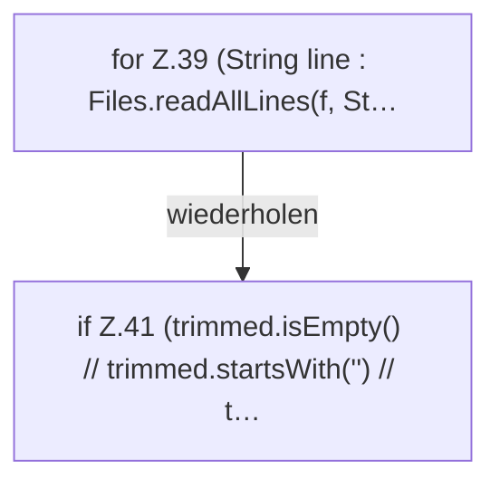

[[00 Start]] › [[Server-Anlage]] › [[Startplan]] › [[PropertiesFile]] › [[PropertiesFile.preview]] › [[PropertiesFile.preview.Z37.Z39]]

# PropertiesFile.preview.Z37.Z39

- Fortsetzung von `PropertiesFile.preview.Z37`, Quellreihenfolge.
