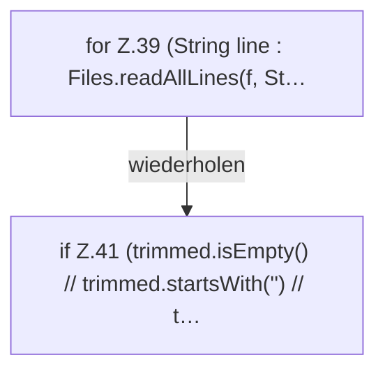

[[00 Start]] › [[Server-Anlage]] › [[Startplan]] › [[PropertiesFile]] › [[PropertiesFile.preview]] › [[PropertiesFile.preview.Z37.Z39]]

# PropertiesFile.preview.Z37.Z39



```knoten
for Z.39 (String line : Files.readAllLines(f, St…
  Zeile 39: Schleife `(String line : Files.readAllLines(f, St…`.
if Z.41 (trimmed.isEmpty() // trimmed.startsWith('') // t…
  Zeile 41: prüft `(trimmed.isEmpty() // trimmed.startsWith('') // t…`.
```

> [!knoten]- Was die Blöcke tun
> - **for Z.39 (String line : Files.readAllLines(f, St…**: Zeile 39: Schleife `(String line : Files.readAllLines(f, St…`.
> - **if Z.41 (trimmed.isEmpty() // trimmed.startsWith('') // t…**: Zeile 41: prüft `(trimmed.isEmpty() // trimmed.startsWith('') // t…`.

- Der Ablauf geht in [[Glossar#Zeile|Zeile]] 39 weiter. Eine Ebene tiefer steht er genauer.
- Fortsetzung von `PropertiesFile.preview.Z37`.
