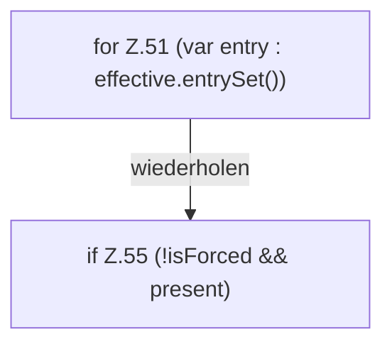

[[00 Start]] › [[Server-Anlage]] › [[Startplan]] › [[PropertiesFile]] › [[PropertiesFile.preview]] › [[PropertiesFile.preview.Z51]]

# PropertiesFile.preview.Z51

- Fortsetzung von `PropertiesFile.preview`, Quellreihenfolge.
