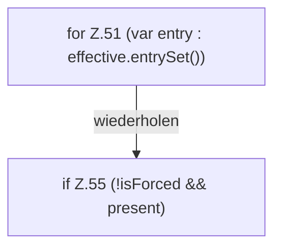

[[00 Start]] › [[Server-Anlage]] › [[Startplan]] › [[PropertiesFile]] › [[PropertiesFile.preview]] › [[PropertiesFile.preview.Z51]]

# PropertiesFile.preview.Z51



```knoten
for Z.51 (var entry : effective.entrySet())
  Zeile 51: Schleife `(var entry : effective.entrySet())`.
if Z.55 (!isForced && present)
  Zeile 55: prüft `(!isForced && present)`.
```

> [!knoten]- Was die Blöcke tun
> - **for Z.51 (var entry : effective.entrySet())**: Zeile 51: Schleife `(var entry : effective.entrySet())`.
> - **if Z.55 (!isForced && present)**: Zeile 55: prüft `(!isForced && present)`.

- Der Ablauf geht in [[Glossar#Zeile|Zeile]] 51 weiter. Eine Ebene tiefer steht er genauer.
- Fortsetzung von `PropertiesFile.preview`.
