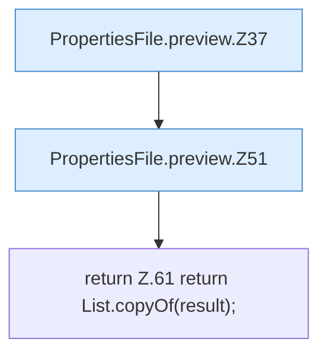

[[00 Start]] › [[Server-Anlage]] › [[Startplan]] › [[PropertiesFile]] › [[PropertiesFile.preview]]

# PropertiesFile.preview

`PropertiesFile.preview(Path f, Map<String, String> force, Map<String, String> defaults)` [src/main/java/de/aichele/childlauncher/PropertiesFile.java:35–62](https://github.com/Sciddie/minecraft-serverhoster-plugin/blob/95b02b953b0b4c23673e900e021a7c3c844aa37d/src/main/java/de/aichele/childlauncher/PropertiesFile.java#L35-L62)



```knoten
PropertiesFile.preview.Z37
  Fortsetzung des Ablaufs ab Zeile 37.
PropertiesFile.preview.Z51
  Fortsetzung des Ablaufs ab Zeile 51.
return Z.61 return List.copyOf(result);
  Zeile 61: Rückgabe `return List.copyOf(result);`.
```

- `preview` in `src/main/java/de/aichele/childlauncher/PropertiesFile.java`
