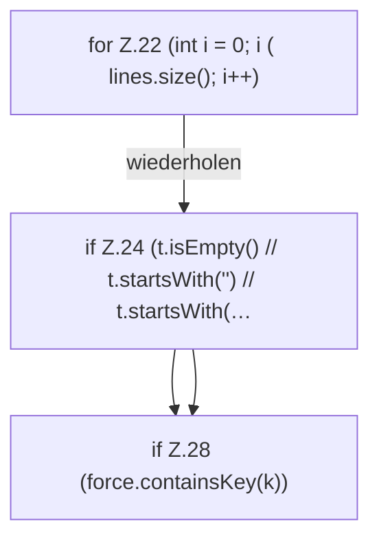

[[00 Start]] › [[Server-Anlage]] › [[Startplan]] › [[PropertiesFile]] › [[PropertiesFile.update]] › [[PropertiesFile.update.Z22]]

# PropertiesFile.update.Z22

- Fortsetzung von `PropertiesFile.update`, Quellreihenfolge.
