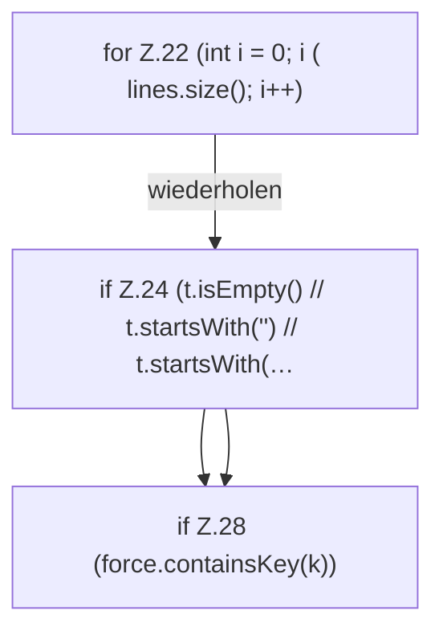

[[00 Start]] › [[Server-Anlage]] › [[Startplan]] › [[PropertiesFile]] › [[PropertiesFile.update]] › [[PropertiesFile.update.Z22]]

# PropertiesFile.update.Z22



```knoten
for Z.22 (int i = 0; i ( lines.size(); i++)
  Zeile 22: Schleife `(int i = 0; i ( lines.size(); i++)`.
if Z.24 (t.isEmpty() // t.startsWith('') // t.startsWith(…
  Zeile 24: prüft `(t.isEmpty() // t.startsWith('') // t.startsWith(…`.
if Z.28 (force.containsKey(k))
  Zeile 28: prüft `(force.containsKey(k))`.
```

> [!knoten]- Was die Blöcke tun
> - **for Z.22 (int i = 0; i ( lines.size(); i++)**: Zeile 22: Schleife `(int i = 0; i ( lines.size(); i++)`.
> - **if Z.24 (t.isEmpty() // t.startsWith('') // t.startsWith(…**: Zeile 24: prüft `(t.isEmpty() // t.startsWith('') // t.startsWith(…`.
> - **if Z.28 (force.containsKey(k))**: Zeile 28: prüft `(force.containsKey(k))`.

- Der Ablauf geht in [[Glossar#Zeile|Zeile]] 22 weiter. Eine Ebene tiefer steht er genauer.
- Fortsetzung von `PropertiesFile.update`.
