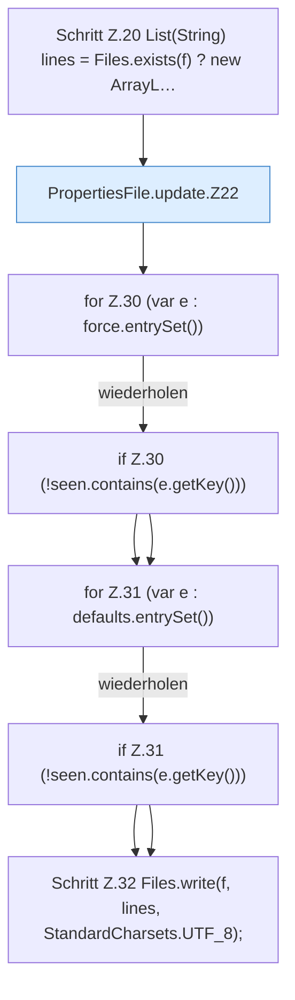

[[00 Start]] › [[Server-Anlage]] › [[Startplan]] › [[PropertiesFile]] › [[PropertiesFile.update]]

# PropertiesFile.update

`PropertiesFile.update(Path f, Map<String, String> force, Map<String, String> defaults)` [src/main/java/de/aichele/childlauncher/PropertiesFile.java:19–33](https://github.com/Sciddie/minecraft-serverhoster-plugin/blob/95b02b953b0b4c23673e900e021a7c3c844aa37d/src/main/java/de/aichele/childlauncher/PropertiesFile.java#L19-L33)



```knoten
Schritt Z.20 List(String) lines = Files.exists(f) ? new ArrayL…
  Zeile 20: Dateioperation. `List(String) lines = Files.exists(f) ? new ArrayL…`
PropertiesFile.update.Z22
  Der Ablauf geht in [[Glossar#Zeile|Zeile]] 22 weiter. Eine Ebene tiefer steht er genauer. Fortsetzung des Ablaufs ab Zeile 22.
for Z.30 (var e : force.entrySet())
  Zeile 30: Schleife `(var e : force.entrySet())`.
if Z.30 (!seen.contains(e.getKey()))
  Zeile 30: prüft `(!seen.contains(e.getKey()))`.
for Z.31 (var e : defaults.entrySet())
  Zeile 31: Schleife `(var e : defaults.entrySet())`.
if Z.31 (!seen.contains(e.getKey()))
  Zeile 31: prüft `(!seen.contains(e.getKey()))`.
Schritt Z.32 Files.write(f, lines, StandardCharsets.UTF_8);
  Zeile 32: Dateioperation. `Files.write(f, lines, StandardCharsets.UTF_8);`
```

> [!knoten]- Was die Blöcke tun
> - **Schritt Z.20 List(String) lines = Files.exists(f) ? new ArrayL…**: Zeile 20: Dateioperation. `List(String) lines = Files.exists(f) ? new ArrayL…`
> - **PropertiesFile.update.Z22**: Der Ablauf geht in [[Glossar#Zeile|Zeile]] 22 weiter. Eine Ebene tiefer steht er genauer. Fortsetzung des Ablaufs ab Zeile 22.
> - **for Z.30 (var e : force.entrySet())**: Zeile 30: Schleife `(var e : force.entrySet())`.
> - **if Z.30 (!seen.contains(e.getKey()))**: Zeile 30: prüft `(!seen.contains(e.getKey()))`.
> - **for Z.31 (var e : defaults.entrySet())**: Zeile 31: Schleife `(var e : defaults.entrySet())`.
> - **if Z.31 (!seen.contains(e.getKey()))**: Zeile 31: prüft `(!seen.contains(e.getKey()))`.
> - **Schritt Z.32 Files.write(f, lines, StandardCharsets.UTF_8);**: Zeile 32: Dateioperation. `Files.write(f, lines, StandardCharsets.UTF_8);`

- Dieser Teil ändert das.
- `update` in `src/main/java/de/aichele/childlauncher/PropertiesFile.java`
