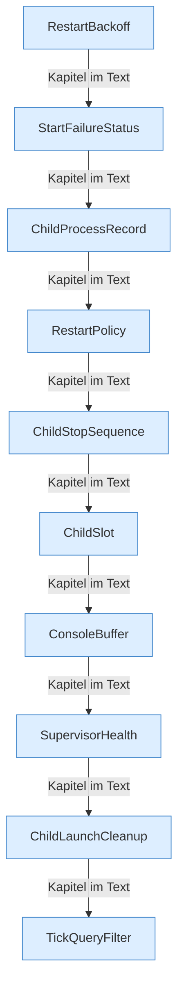

[[00 Start]] › [[Child-Prozess]] › [[Prozess-Bausteine]]

# Prozess-Bausteine



```knoten
RestartBackoff
  Rechnet die [[Glossar#Pause|Pause]] vor dem nächsten [[Glossar#Neustart|Neustart]] aus.
StartFailureStatus
  Merkt sich, woran ein Start gescheitert ist, damit man es in der [[Glossar#Bedienseite|Bedienseite]] sieht.
ChildProcessRecord
  Der Merkzettel zum laufenden Programm: Nummer, ob es noch lebt, und wie man es beendet.
RestartPolicy
  Die Regel, ob und wie oft der [[Glossar#Spielserver|Spielserver]] von allein neu starten darf.
ChildStopSequence
  Die Schritte des [[Glossar#Stopp|Stopps]]: nachfragen, die Bitte wiederholen, dann hart beenden.
ChildSlot
  Der [[Glossar#Platz|Platz]] des [[Glossar#Spielserver|Spielservers]]: Zustand, Programmnummer, [[Glossar#Konsole|Konsole]] und Messwerte.
ConsoleBuffer
  Ein kurzer Speicher für die letzten [[Glossar#Zeile|Zeilen]] der [[Glossar#Konsole|Konsole]], damit die [[Glossar#Bedienseite|Bedienseite]] sie zeigen kann.
SupervisorHealth
  Die vier Zustände aus, startet, läuft und stoppt, und die [[Glossar#Aufsicht|Aufsicht]] darüber.
ChildLaunchCleanup
  Räumt Dateien und übrig gebliebene Programme weg, wenn ein Start nicht geklappt hat.
TickQueryFilter
  Erkennt die Antwort auf die Frage nach dem letzten [[Glossar#Spielschritt|Spielschritt]] und lässt andere [[Glossar#Zeile|Zeilen]] links liegen.
```

> [!knoten] Was die Blöcke tun
> - **RestartBackoff**: Rechnet die [[Glossar#Pause|Pause]] vor dem nächsten [[Glossar#Neustart|Neustart]] aus.
> - **StartFailureStatus**: Merkt sich, woran ein Start gescheitert ist, damit man es in der [[Glossar#Bedienseite|Bedienseite]] sieht.
> - **ChildProcessRecord**: Der Merkzettel zum laufenden Programm: Nummer, ob es noch lebt, und wie man es beendet.
> - **RestartPolicy**: Die Regel, ob und wie oft der [[Glossar#Spielserver|Spielserver]] von allein neu starten darf.
> - **ChildStopSequence**: Die Schritte des [[Glossar#Stopp|Stopps]]: nachfragen, die Bitte wiederholen, dann hart beenden.
> - **ChildSlot**: Der [[Glossar#Platz|Platz]] des [[Glossar#Spielserver|Spielservers]]: Zustand, Programmnummer, [[Glossar#Konsole|Konsole]] und Messwerte.
> - **ConsoleBuffer**: Ein kurzer Speicher für die letzten [[Glossar#Zeile|Zeilen]] der [[Glossar#Konsole|Konsole]], damit die [[Glossar#Bedienseite|Bedienseite]] sie zeigen kann.
> - **SupervisorHealth**: Die vier Zustände aus, startet, läuft und stoppt, und die [[Glossar#Aufsicht|Aufsicht]] darüber.
> - **ChildLaunchCleanup**: Räumt Dateien und übrig gebliebene Programme weg, wenn ein Start nicht geklappt hat.
> - **TickQueryFilter**: Erkennt die Antwort auf die Frage nach dem letzten [[Glossar#Spielschritt|Spielschritt]] und lässt andere [[Glossar#Zeile|Zeilen]] links liegen.

- Die Zettel, auf denen Zustand, Programmnummer, [[Glossar#Konsole|Konsole]] und [[Glossar#Pause|Pausen]] stehen. Hier läuft nichts von selbst ab.
