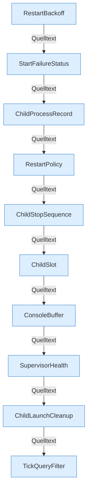

[[00 Start]] › [[Child-Prozess]] › [[Prozess-Bausteine]]

# Prozess-Bausteine



```knoten
RestartBackoff
  Wartezeit aus Versuchen, Basis und Deckel.
StartFailureStatus
  Merkt, woran der Start gescheitert ist.
ChildProcessRecord
  Der gemerkte Prozess: pid, lebendig, zerstören.
RestartPolicy
  Ob und wie oft der Child von allein neu startet.
ChildStopSequence
  Stoppt den Prozess: Poll 250 ms, Befehl erneut, dann TERM.
ChildSlot
  Phase, pid, Konsole und Messwerte des einen Child.
ConsoleBuffer
  Ringpuffer der Konsolenzeilen.
SupervisorHealth
  Phase IDLE, PREPARING, RUNNING, STOPPING und die 5-s-Aufsicht.
ChildLaunchCleanup
  Räumt Dateien und übrige Prozesse nach einem fehlgeschlagenen Start weg.
TickQueryFilter
  Erkennt die Antwort auf tick query und verwirft den Rest.
```

- Slot, Prozessrecord, Stoppsequenz, Restart, Supervisor.
