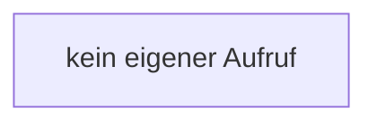

[[00 Start]] › [[Backup]] › [[Backup-Bruecken]] › [[RemoteBackupBridge]] › [[CountingOutputStream]] › [[RemoteBackupBridge.CountingOutputStream.CountingOutputStream]]

# RemoteBackupBridge.CountingOutputStream.CountingOutputStream

`RemoteBackupBridge.CountingOutputStream.CountingOutputStream(OutputStream out)` [src/main/java/de/aichele/childlauncher/RemoteBackupBridge.java:330–330](https://github.com/Sciddie/minecraft-serverhoster-plugin/blob/95b02b953b0b4c23673e900e021a7c3c844aa37d/src/main/java/de/aichele/childlauncher/RemoteBackupBridge.java#L330-L330)



```knoten
kein eigener Aufruf
  In diesem Stück gibt es keinen weiteren eigenen Aufruf.
```

> [!knoten]- Was die Blöcke tun
> - **kein eigener Aufruf**: In diesem Stück gibt es keinen weiteren eigenen Aufruf.

- Die Sicherung über das Netz macht hier einen einzelnen Schritt. Eine Ebene tiefer steht er genauer.
- `CountingOutputStream` in `src/main/java/de/aichele/childlauncher/RemoteBackupBridge.java`
