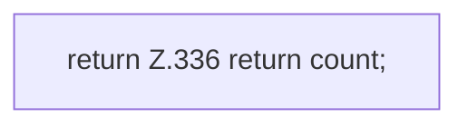

[[00 Start]] › [[Backup]] › [[Backup-Bruecken]] › [[RemoteBackupBridge]] › [[CountingOutputStream]] › [[RemoteBackupBridge.CountingOutputStream.count]]

# RemoteBackupBridge.CountingOutputStream.count

`RemoteBackupBridge.CountingOutputStream.count()` [src/main/java/de/aichele/childlauncher/RemoteBackupBridge.java:336–336](https://github.com/Sciddie/minecraft-serverhoster-plugin/blob/95b02b953b0b4c23673e900e021a7c3c844aa37d/src/main/java/de/aichele/childlauncher/RemoteBackupBridge.java#L336-L336)



```knoten
return Z.336 return count;
  Zeile 336: Rückgabe `return count;`.
```

- `count` in `src/main/java/de/aichele/childlauncher/RemoteBackupBridge.java`
