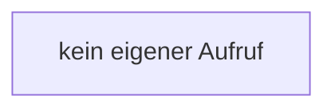

[[00 Start]] › [[Backup]] › [[Backup-Bruecken]] › [[RemoteBackupBridge]] › [[CountingOutputStream]] › [[RemoteBackupBridge.CountingOutputStream.write(byteArray,int,int)]]

# RemoteBackupBridge.CountingOutputStream.write(byteArray,int,int)

`RemoteBackupBridge.CountingOutputStream.write(byte[] bytes, int offset, int length)` [src/main/java/de/aichele/childlauncher/RemoteBackupBridge.java:332–335](https://github.com/Sciddie/minecraft-serverhoster-plugin/blob/95b02b953b0b4c23673e900e021a7c3c844aa37d/src/main/java/de/aichele/childlauncher/RemoteBackupBridge.java#L332-L335)



```knoten
kein eigener Aufruf
  In diesem Stück gibt es keinen weiteren eigenen Aufruf.
```

- `write` in `src/main/java/de/aichele/childlauncher/RemoteBackupBridge.java`
