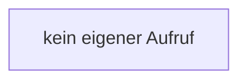

[[00 Start]] › [[Backup]] › [[Backup-Bruecken]] › [[RemoteBackupBridge]] › [[RemoteBackupBridge.Teil1]] › [[RemoteBackupBridge.RemoteBackupBridge]]

# RemoteBackupBridge.RemoteBackupBridge

`RemoteBackupBridge.RemoteBackupBridge()` [src/main/java/de/aichele/childlauncher/RemoteBackupBridge.java:58–58](https://github.com/Sciddie/minecraft-serverhoster-plugin/blob/95b02b953b0b4c23673e900e021a7c3c844aa37d/src/main/java/de/aichele/childlauncher/RemoteBackupBridge.java#L58-L58)



```knoten
kein eigener Aufruf
  In diesem Stück gibt es keinen weiteren eigenen Aufruf.
```

- `RemoteBackupBridge` in `src/main/java/de/aichele/childlauncher/RemoteBackupBridge.java`
