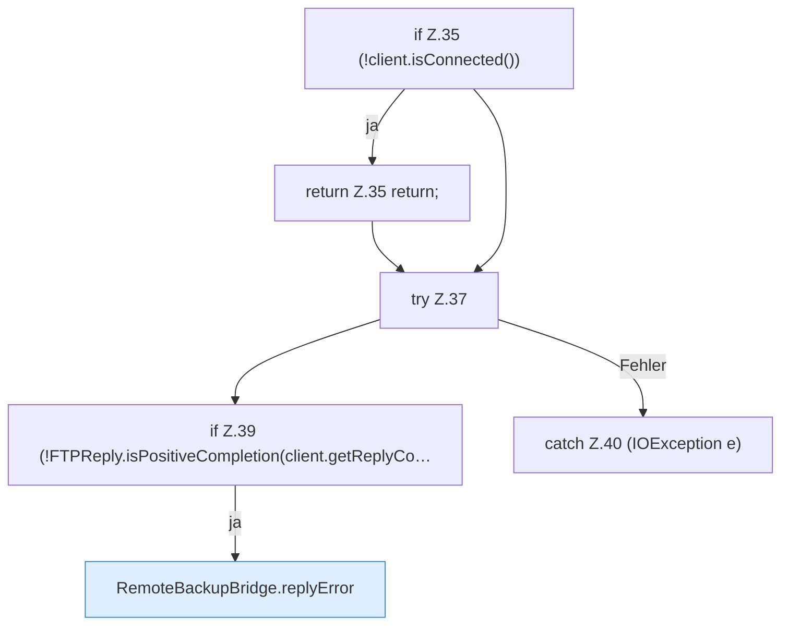

[[00 Start]] › [[Backup]] › [[Backup-Bruecken]] › [[RemoteBackupBridge]] › [[Session]] › [[RemoteBackupBridge.Session.close]] › [[RemoteBackupBridge.Session.close.Teil1]]

# RemoteBackupBridge.Session.close.Teil1



```knoten
if Z.35 (!client.isConnected())
  Zeile 35: prüft `(!client.isConnected())`.
return Z.35 return;
  Zeile 35: Rückgabe `return;`.
try Z.37
  Zeile 37: Versuch. Der Fehlerpfad geht in catch.
if Z.39 (!FTPReply.isPositiveCompletion(client.getReplyCo…
  Zeile 39: prüft `(!FTPReply.isPositiveCompletion(client.getReplyCo…`.
RemoteBackupBridge.replyError
  Die Sicherung über das Netz macht hier einen einzelnen Schritt. Eine Ebene tiefer steht er genauer. Antwortet `replyError`.
catch Z.40 (IOException e)
  Zeile 40: fängt (IOException e).
```

> [!knoten]- Was die Blöcke tun
> - **if Z.35 (!client.isConnected())**: Zeile 35: prüft `(!client.isConnected())`.
> - **return Z.35 return;**: Zeile 35: Rückgabe `return;`.
> - **try Z.37**: Zeile 37: Versuch. Der Fehlerpfad geht in catch.
> - **if Z.39 (!FTPReply.isPositiveCompletion(client.getReplyCo…**: Zeile 39: prüft `(!FTPReply.isPositiveCompletion(client.getReplyCo…`.
> - **RemoteBackupBridge.replyError**: Die Sicherung über das Netz macht hier einen einzelnen Schritt. Eine Ebene tiefer steht er genauer. Antwortet `replyError`.
> - **catch Z.40 (IOException e)**: Zeile 40: fängt (IOException e).

- Ein weiterer Abschnitt derselben Übersicht.
- Fortsetzung von `RemoteBackupBridge.Session.close`.
