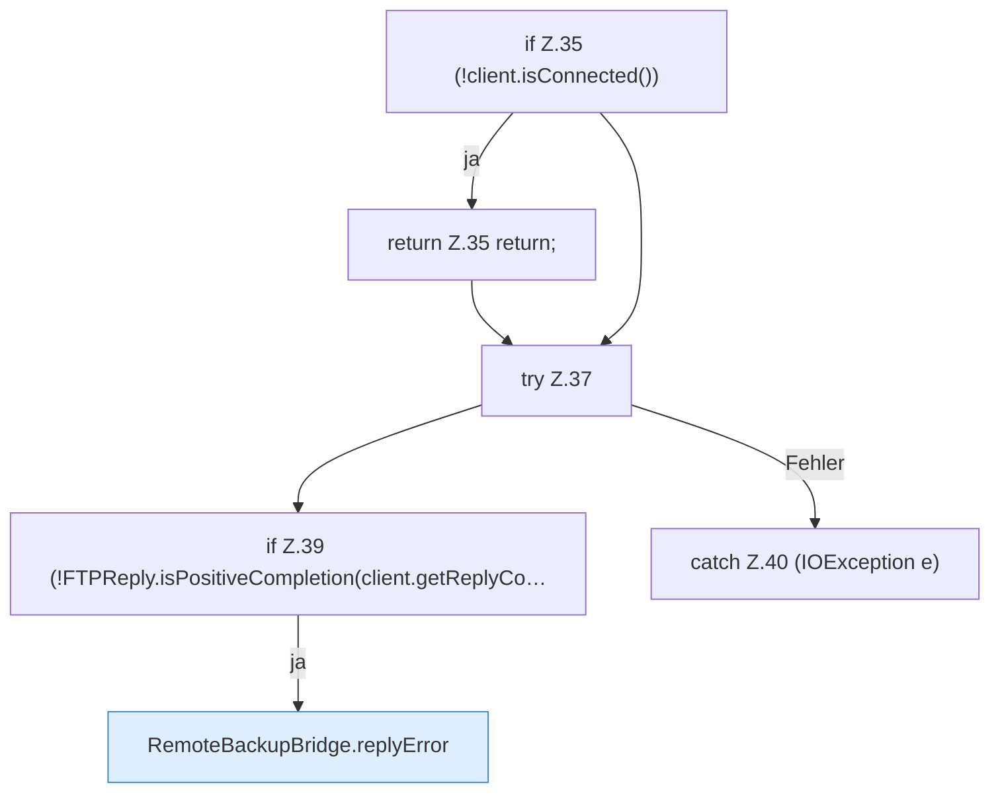

[[00 Start]] › [[Backup]] › [[Backup-Bruecken]] › [[RemoteBackupBridge]] › [[Session]] › [[RemoteBackupBridge.Session.close]] › [[RemoteBackupBridge.Session.close.Teil1]]

# RemoteBackupBridge.Session.close.Teil1

- Fortsetzung von `RemoteBackupBridge.Session.close`, Quellreihenfolge.
