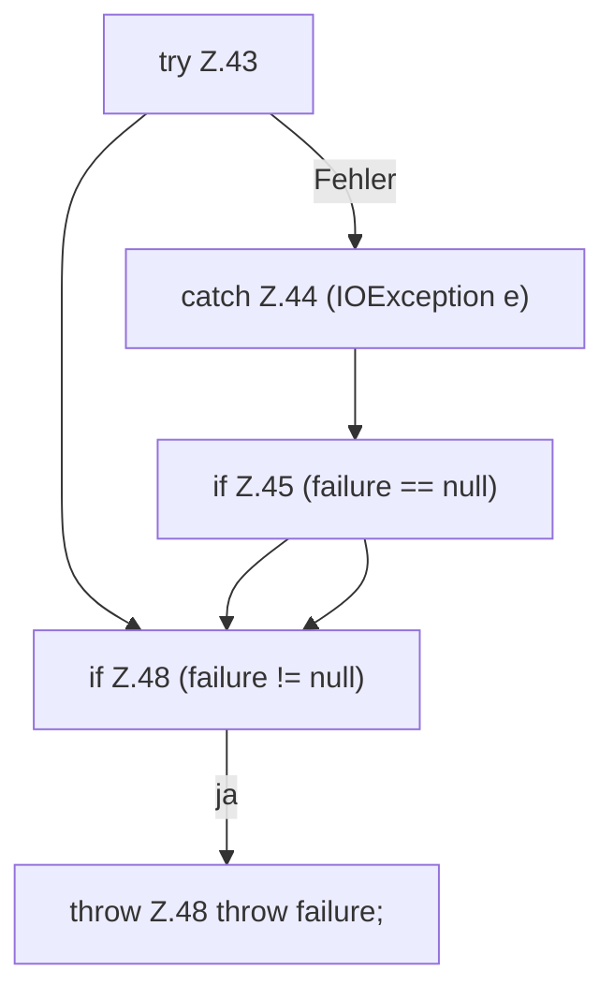

[[00 Start]] › [[Backup]] › [[Backup-Bruecken]] › [[RemoteBackupBridge]] › [[Session]] › [[RemoteBackupBridge.Session.close]] › [[RemoteBackupBridge.Session.close.Teil2]]

# RemoteBackupBridge.Session.close.Teil2



```knoten
try Z.43
  Zeile 43: Versuch. Der Fehlerpfad geht in catch.
catch Z.44 (IOException e)
  Zeile 44: fängt (IOException e).
if Z.45 (failure == null)
  Zeile 45: prüft `(failure == null)`.
if Z.48 (failure != null)
  Zeile 48: prüft `(failure != null)`.
throw Z.48 throw failure;
  Zeile 48: Abbruch `throw failure;`.
```

- Fortsetzung von `RemoteBackupBridge.Session.close`, Quellreihenfolge.
