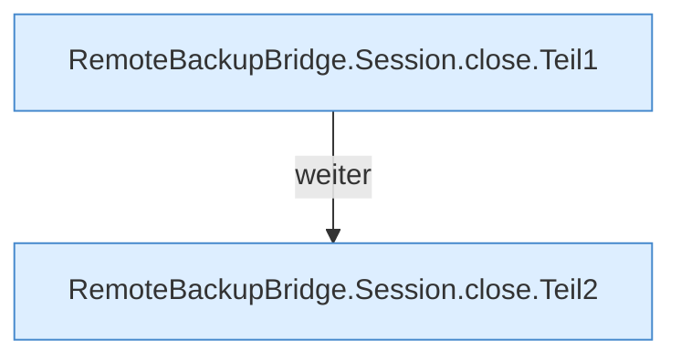

[[00 Start]] › [[Backup]] › [[Backup-Bruecken]] › [[RemoteBackupBridge]] › [[Session]] › [[RemoteBackupBridge.Session.close]]

# RemoteBackupBridge.Session.close

`RemoteBackupBridge.Session.close()` [src/main/java/de/aichele/childlauncher/RemoteBackupBridge.java:34–49](https://github.com/Sciddie/minecraft-serverhoster-plugin/blob/95b02b953b0b4c23673e900e021a7c3c844aa37d/src/main/java/de/aichele/childlauncher/RemoteBackupBridge.java#L34-L49)



```knoten
RemoteBackupBridge.Session.close.Teil1
  Ein weiterer Abschnitt derselben Übersicht. Abschnitt 1 dieses Ablaufs, in Quellreihenfolge.
RemoteBackupBridge.Session.close.Teil2
  Ein weiterer Abschnitt derselben Übersicht. Abschnitt 2 dieses Ablaufs, in Quellreihenfolge.
```

> [!knoten]- Was die Blöcke tun
> - **RemoteBackupBridge.Session.close.Teil1**: Ein weiterer Abschnitt derselben Übersicht. Abschnitt 1 dieses Ablaufs, in Quellreihenfolge.
> - **RemoteBackupBridge.Session.close.Teil2**: Ein weiterer Abschnitt derselben Übersicht. Abschnitt 2 dieses Ablaufs, in Quellreihenfolge.

- Die Sicherung über das Netz schließt das.
- `close` in `src/main/java/de/aichele/childlauncher/RemoteBackupBridge.java`
