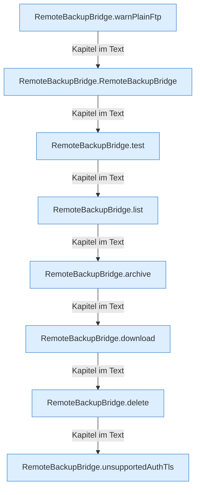

[[00 Start]] › [[Backup]] › [[Backup-Bruecken]] › [[RemoteBackupBridge]] › [[RemoteBackupBridge.Teil1]]

# RemoteBackupBridge.Teil1



```knoten
RemoteBackupBridge.warnPlainFtp
  Die Sicherung über das Netz warnt vor die Übertragung. Warnt `warnPlainFtp`.
RemoteBackupBridge.RemoteBackupBridge
  Die Sicherung über das Netz sichert hier einen Schritt. Eine Ebene tiefer steht er genauer. `RemoteBackupBridge` in `RemoteBackupBridge.java`.
RemoteBackupBridge.test
  Die Sicherung über das Netz prüft das. Prüft `test`. Ruft `connect`, `enterBaseDirectory`.
RemoteBackupBridge.list
  Die Sicherung über das Netz zeigt das. Listet `list`. Ruft `safeId`, `connect`, `enterDirectory`.
RemoteBackupBridge.archive
  Die Sicherung über das Netz macht hier einen einzelnen Schritt. Eine Ebene tiefer steht er genauer. Packt `archive`. Ruft `open`, `safeId`, `connect`.
RemoteBackupBridge.download
  Die Sicherung über das Netz holt das. Liefert zum Herunterladen `download`. Ruft `safeId`, `named`, `connect`.
RemoteBackupBridge.delete
  Die Sicherung über das Netz löscht das. Löscht `delete`. Ruft `safeId`, `named`, `connect`.
RemoteBackupBridge.unsupportedAuthTls
  Die Sicherung über das Netz macht hier einen einzelnen Schritt. Eine Ebene tiefer steht er genauer. `unsupportedAuthTls` in `RemoteBackupBridge.java`.
```

> [!knoten]- Was die Blöcke tun
> - **RemoteBackupBridge.warnPlainFtp**: Die Sicherung über das Netz warnt vor die Übertragung. Warnt `warnPlainFtp`.
> - **RemoteBackupBridge.RemoteBackupBridge**: Die Sicherung über das Netz sichert hier einen Schritt. Eine Ebene tiefer steht er genauer. `RemoteBackupBridge` in `RemoteBackupBridge.java`.
> - **RemoteBackupBridge.test**: Die Sicherung über das Netz prüft das. Prüft `test`. Ruft `connect`, `enterBaseDirectory`.
> - **RemoteBackupBridge.list**: Die Sicherung über das Netz zeigt das. Listet `list`. Ruft `safeId`, `connect`, `enterDirectory`.
> - **RemoteBackupBridge.archive**: Die Sicherung über das Netz macht hier einen einzelnen Schritt. Eine Ebene tiefer steht er genauer. Packt `archive`. Ruft `open`, `safeId`, `connect`.
> - **RemoteBackupBridge.download**: Die Sicherung über das Netz holt das. Liefert zum Herunterladen `download`. Ruft `safeId`, `named`, `connect`.
> - **RemoteBackupBridge.delete**: Die Sicherung über das Netz löscht das. Löscht `delete`. Ruft `safeId`, `named`, `connect`.
> - **RemoteBackupBridge.unsupportedAuthTls**: Die Sicherung über das Netz macht hier einen einzelnen Schritt. Eine Ebene tiefer steht er genauer. `unsupportedAuthTls` in `RemoteBackupBridge.java`.

- Ein weiterer Abschnitt derselben Übersicht.
