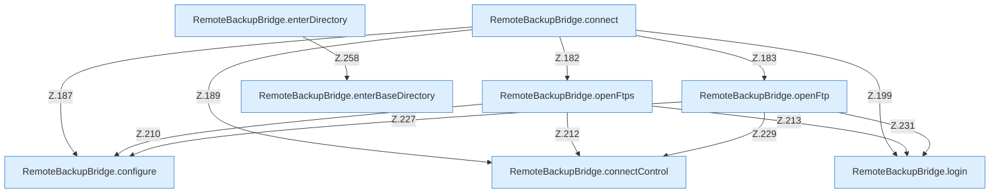

[[00 Start]] › [[Backup]] › [[Backup-Bruecken]] › [[RemoteBackupBridge]] › [[RemoteBackupBridge.Teil2]]

# RemoteBackupBridge.Teil2



```knoten
RemoteBackupBridge.connect
  Die Sicherung über das Netz macht hier einen einzelnen Schritt. Eine Ebene tiefer steht er genauer. Verbindet `connect`. Ruft `validateCredentials`, `openFtps`, `openFtp`.
RemoteBackupBridge.openFtps
  Die Sicherung über das Netz öffnet hier einen Schritt. Eine Ebene tiefer steht er genauer. Öffnet `openFtps`. Ruft `configure`, `connectControl`, `login`.
RemoteBackupBridge.openFtp
  Die Sicherung über das Netz öffnet die Übertragung. Öffnet `openFtp`. Ruft `configure`, `connectControl`, `warnPlainFtp`.
RemoteBackupBridge.connectControl
  Die Sicherung über das Netz macht hier einen einzelnen Schritt. Eine Ebene tiefer steht er genauer. Verbindet `connectControl`. Ruft `replyError`.
RemoteBackupBridge.login
  Die Sicherung über das Netz meldet an bei das. Meldet an `login`. Ruft `replyError`.
RemoteBackupBridge.configure
  Die Sicherung über das Netz macht hier einen einzelnen Schritt. Eine Ebene tiefer steht er genauer. `configure` in `RemoteBackupBridge.java`.
RemoteBackupBridge.enterDirectory
  Die Sicherung über das Netz macht hier einen einzelnen Schritt. Eine Ebene tiefer steht er genauer. Wechselt hinein `enterDirectory`. Ruft `enterBaseDirectory`, `replyError`.
RemoteBackupBridge.enterBaseDirectory
  Die Sicherung über das Netz macht hier einen einzelnen Schritt. Eine Ebene tiefer steht er genauer. Wechselt hinein `enterBaseDirectory`. Ruft `hasControlCharacter`, `replyError`.
```

> [!knoten]- Was die Blöcke tun
> - **RemoteBackupBridge.connect**: Die Sicherung über das Netz macht hier einen einzelnen Schritt. Eine Ebene tiefer steht er genauer. Verbindet `connect`. Ruft `validateCredentials`, `openFtps`, `openFtp`.
> - **RemoteBackupBridge.openFtps**: Die Sicherung über das Netz öffnet hier einen Schritt. Eine Ebene tiefer steht er genauer. Öffnet `openFtps`. Ruft `configure`, `connectControl`, `login`.
> - **RemoteBackupBridge.openFtp**: Die Sicherung über das Netz öffnet die Übertragung. Öffnet `openFtp`. Ruft `configure`, `connectControl`, `warnPlainFtp`.
> - **RemoteBackupBridge.connectControl**: Die Sicherung über das Netz macht hier einen einzelnen Schritt. Eine Ebene tiefer steht er genauer. Verbindet `connectControl`. Ruft `replyError`.
> - **RemoteBackupBridge.login**: Die Sicherung über das Netz meldet an bei das. Meldet an `login`. Ruft `replyError`.
> - **RemoteBackupBridge.configure**: Die Sicherung über das Netz macht hier einen einzelnen Schritt. Eine Ebene tiefer steht er genauer. `configure` in `RemoteBackupBridge.java`.
> - **RemoteBackupBridge.enterDirectory**: Die Sicherung über das Netz macht hier einen einzelnen Schritt. Eine Ebene tiefer steht er genauer. Wechselt hinein `enterDirectory`. Ruft `enterBaseDirectory`, `replyError`.
> - **RemoteBackupBridge.enterBaseDirectory**: Die Sicherung über das Netz macht hier einen einzelnen Schritt. Eine Ebene tiefer steht er genauer. Wechselt hinein `enterBaseDirectory`. Ruft `hasControlCharacter`, `replyError`.

- Ein weiterer Abschnitt derselben Übersicht.
