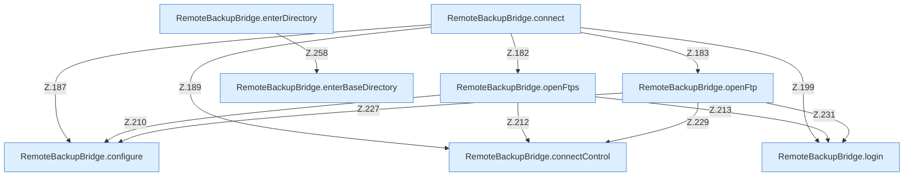

[[00 Start]] › [[Backup]] › [[Backup-Bruecken]] › [[RemoteBackupBridge]] › [[RemoteBackupBridge.Teil2]]

# RemoteBackupBridge.Teil2



```knoten
RemoteBackupBridge.connect
  Verbindet `connect`. Ruft `validateCredentials`, `openFtps`, `openFtp`.
RemoteBackupBridge.openFtps
  Öffnet `openFtps`. Ruft `configure`, `connectControl`, `login`.
RemoteBackupBridge.openFtp
  Öffnet `openFtp`. Ruft `configure`, `connectControl`, `warnPlainFtp`.
RemoteBackupBridge.connectControl
  Verbindet `connectControl`. Ruft `replyError`.
RemoteBackupBridge.login
  Meldet an `login`. Ruft `replyError`.
RemoteBackupBridge.configure
  `configure` in `RemoteBackupBridge.java`.
RemoteBackupBridge.enterDirectory
  Wechselt hinein `enterDirectory`. Ruft `enterBaseDirectory`, `replyError`.
RemoteBackupBridge.enterBaseDirectory
  Wechselt hinein `enterBaseDirectory`. Ruft `hasControlCharacter`, `replyError`.
```


