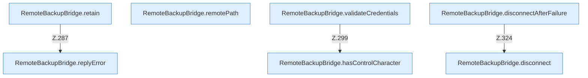

[[00 Start]] › [[Backup]] › [[Backup-Bruecken]] › [[RemoteBackupBridge]] › [[RemoteBackupBridge.Teil3]]

# RemoteBackupBridge.Teil3



```knoten
RemoteBackupBridge.retain
  Die Sicherung über das Netz macht hier einen einzelnen Schritt. Eine Ebene tiefer steht er genauer. Behält die letzten Stücke `retain`. Ruft `named`, `replyError`.
RemoteBackupBridge.remotePath
  Die Sicherung über das Netz kümmert sich um den Pfad. `remotePath` in `RemoteBackupBridge.java`.
RemoteBackupBridge.validateCredentials
  Die Sicherung über das Netz prüft die Zugangsdaten. Prüft `validateCredentials`. Ruft `hasControlCharacter`.
RemoteBackupBridge.hasControlCharacter
  Die Sicherung über das Netz prüft hier einen Schritt. Eine Ebene tiefer steht er genauer. Prüft `hasControlCharacter`.
RemoteBackupBridge.replyError
  Die Sicherung über das Netz macht hier einen einzelnen Schritt. Eine Ebene tiefer steht er genauer. Antwortet `replyError`.
RemoteBackupBridge.disconnect
  Die Sicherung über das Netz macht hier einen einzelnen Schritt. Eine Ebene tiefer steht er genauer. Trennt `disconnect`.
RemoteBackupBridge.disconnectAfterFailure
  Die Sicherung über das Netz macht hier einen einzelnen Schritt. Eine Ebene tiefer steht er genauer. Trennt `disconnectAfterFailure`. Ruft `disconnect`.
```

> [!knoten]- Was die Blöcke tun
> - **RemoteBackupBridge.retain**: Die Sicherung über das Netz macht hier einen einzelnen Schritt. Eine Ebene tiefer steht er genauer. Behält die letzten Stücke `retain`. Ruft `named`, `replyError`.
> - **RemoteBackupBridge.remotePath**: Die Sicherung über das Netz kümmert sich um den Pfad. `remotePath` in `RemoteBackupBridge.java`.
> - **RemoteBackupBridge.validateCredentials**: Die Sicherung über das Netz prüft die Zugangsdaten. Prüft `validateCredentials`. Ruft `hasControlCharacter`.
> - **RemoteBackupBridge.hasControlCharacter**: Die Sicherung über das Netz prüft hier einen Schritt. Eine Ebene tiefer steht er genauer. Prüft `hasControlCharacter`.
> - **RemoteBackupBridge.replyError**: Die Sicherung über das Netz macht hier einen einzelnen Schritt. Eine Ebene tiefer steht er genauer. Antwortet `replyError`.
> - **RemoteBackupBridge.disconnect**: Die Sicherung über das Netz macht hier einen einzelnen Schritt. Eine Ebene tiefer steht er genauer. Trennt `disconnect`.
> - **RemoteBackupBridge.disconnectAfterFailure**: Die Sicherung über das Netz macht hier einen einzelnen Schritt. Eine Ebene tiefer steht er genauer. Trennt `disconnectAfterFailure`. Ruft `disconnect`.

- Ein weiterer Abschnitt derselben Übersicht.
