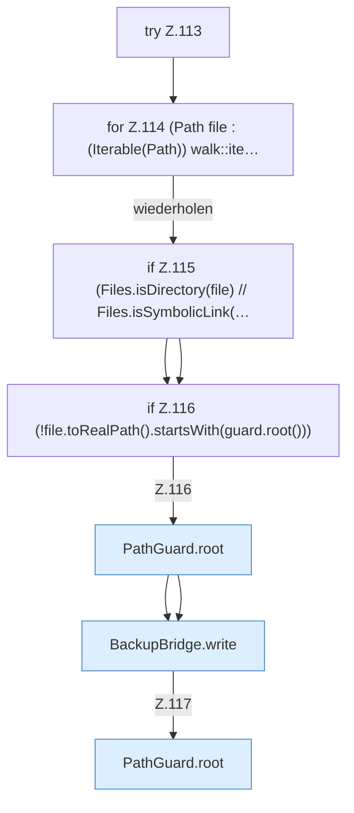

[[00 Start]] › [[Backup]] › [[Backup-Bruecken]] › [[RemoteBackupBridge]] › [[RemoteBackupBridge.Teil1]] › [[RemoteBackupBridge.archive]] › [[RemoteBackupBridge.archive.Z92.Teil1.Z99.Teil1.Z104.Z107.Z112.Z113]]

# RemoteBackupBridge.archive.Z92.Teil1.Z99.Teil1.Z104.Z107.Z112.Z113



```knoten
try Z.113
  Zeile 113: Versuch. Der Fehlerpfad geht in catch.
for Z.114 (Path file : (Iterable(Path)) walk::ite…
  Zeile 114: Schleife `(Path file : (Iterable(Path)) walk::ite…`.
if Z.115 (Files.isDirectory(file) // Files.isSymbolicLink(…
  Zeile 115: prüft `(Files.isDirectory(file) // Files.isSymbolicLink(…`.
if Z.116 (!file.toRealPath().startsWith(guard.root()))
  Zeile 116: prüft `(!file.toRealPath().startsWith(guard.root()))`.
PathGuard.root
  Liefert die Wurzel `root`.
BackupBridge.write
  Schreibt `write`.
```

- Fortsetzung von `RemoteBackupBridge.archive.Z92.Teil1.Z99.Teil1.Z104.Z107.Z112`, Quellreihenfolge.
