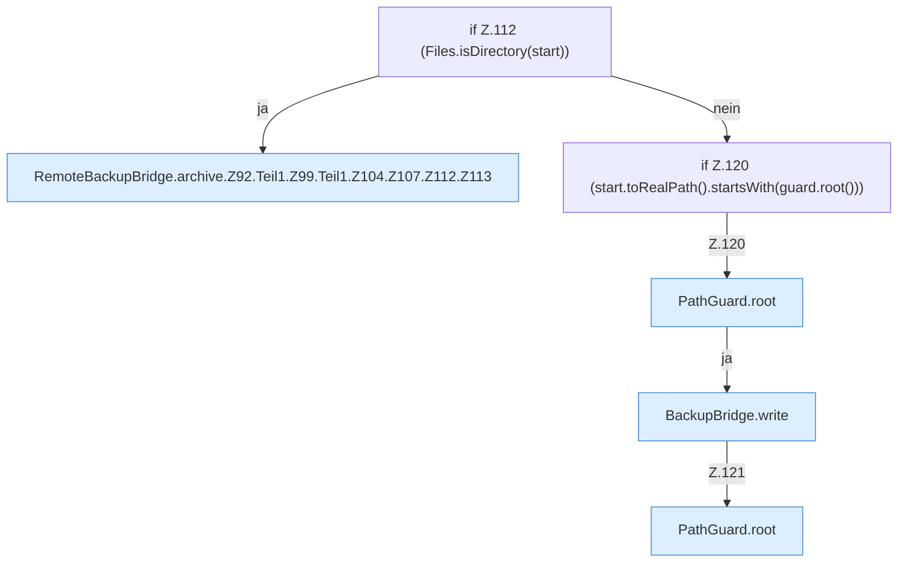

[[00 Start]] › [[Backup]] › [[Backup-Bruecken]] › [[RemoteBackupBridge]] › [[RemoteBackupBridge.Teil1]] › [[RemoteBackupBridge.archive]] › [[RemoteBackupBridge.archive.Z92.Teil1.Z99.Teil1.Z104.Z107.Z112]]

# RemoteBackupBridge.archive.Z92.Teil1.Z99.Teil1.Z104.Z107.Z112



```knoten
if Z.112 (Files.isDirectory(start))
  Zeile 112: prüft `(Files.isDirectory(start))`.
RemoteBackupBridge.archive.Z92.Teil1.Z99.Teil1.Z104.Z107.Z112.Z113
  Der Ablauf geht in [[Glossar#Zeile|Zeile]] 113 weiter. Eine Ebene tiefer steht er genauer. Fortsetzung des Ablaufs ab Zeile 113.
if Z.120 (start.toRealPath().startsWith(guard.root()))
  Zeile 120: prüft `(start.toRealPath().startsWith(guard.root()))`.
PathGuard.root
  Dieser Teil macht hier einen einzelnen Schritt. Eine Ebene tiefer steht er genauer. Liefert die Wurzel `root`.
BackupBridge.write
  Die Sicherung auf diesem Rechner schreibt das. Schreibt `write`.
```

> [!knoten]- Was die Blöcke tun
> - **if Z.112 (Files.isDirectory(start))**: Zeile 112: prüft `(Files.isDirectory(start))`.
> - **RemoteBackupBridge.archive.Z92.Teil1.Z99.Teil1.Z104.Z107.Z112.Z113**: Der Ablauf geht in [[Glossar#Zeile|Zeile]] 113 weiter. Eine Ebene tiefer steht er genauer. Fortsetzung des Ablaufs ab Zeile 113.
> - **if Z.120 (start.toRealPath().startsWith(guard.root()))**: Zeile 120: prüft `(start.toRealPath().startsWith(guard.root()))`.
> - **PathGuard.root**: Dieser Teil macht hier einen einzelnen Schritt. Eine Ebene tiefer steht er genauer. Liefert die Wurzel `root`.
> - **BackupBridge.write**: Die Sicherung auf diesem Rechner schreibt das. Schreibt `write`.

- Der Ablauf geht in [[Glossar#Zeile|Zeile]] 112 weiter. Eine Ebene tiefer steht er genauer.
- Fortsetzung von `RemoteBackupBridge.archive.Z92.Teil1.Z99.Teil1.Z104.Z107`.
