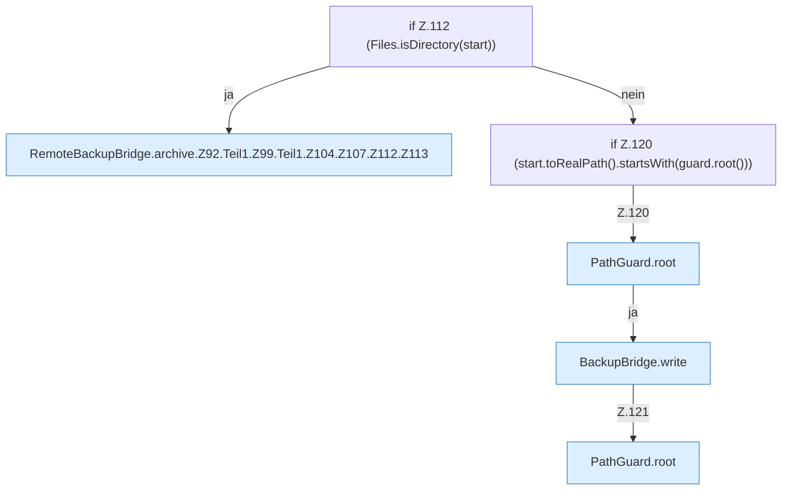

[[00 Start]] › [[Backup]] › [[Backup-Bruecken]] › [[RemoteBackupBridge]] › [[RemoteBackupBridge.Teil1]] › [[RemoteBackupBridge.archive]] › [[RemoteBackupBridge.archive.Z92.Teil1.Z99.Teil1.Z104.Z107.Z112]]

# RemoteBackupBridge.archive.Z92.Teil1.Z99.Teil1.Z104.Z107.Z112

- Fortsetzung von `RemoteBackupBridge.archive.Z92.Teil1.Z99.Teil1.Z104.Z107`, Quellreihenfolge.
