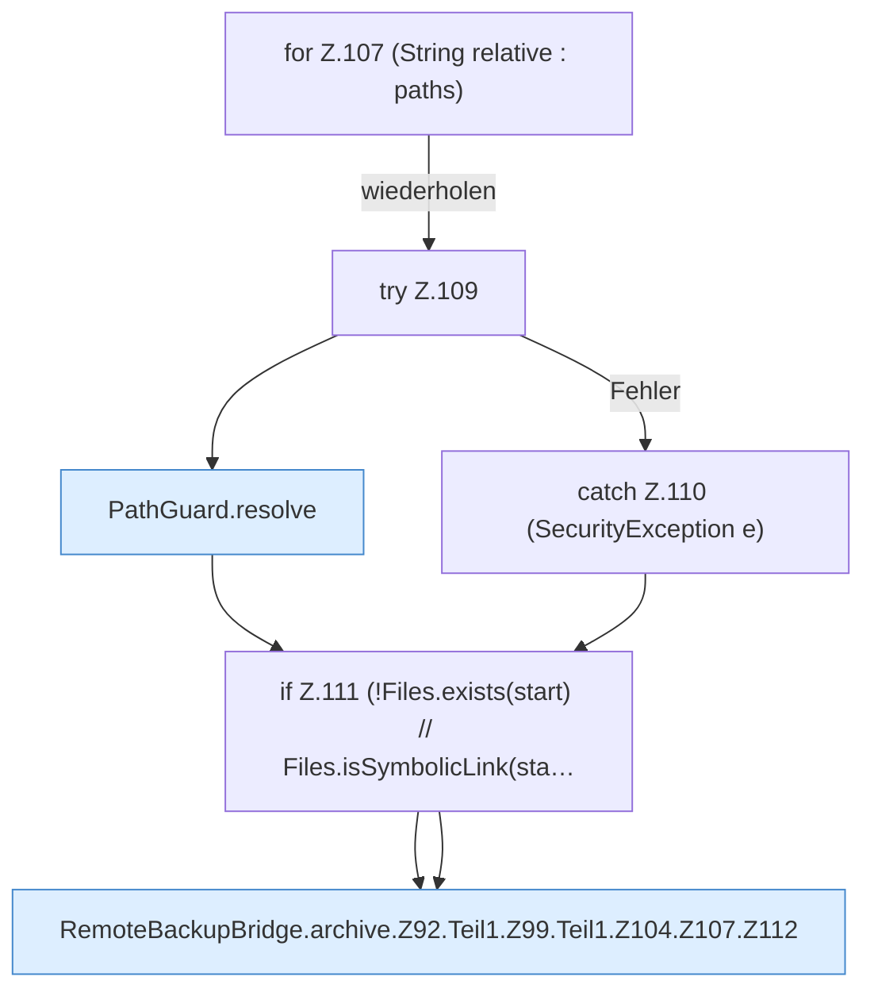

[[00 Start]] › [[Backup]] › [[Backup-Bruecken]] › [[RemoteBackupBridge]] › [[RemoteBackupBridge.Teil1]] › [[RemoteBackupBridge.archive]] › [[RemoteBackupBridge.archive.Z92.Teil1.Z99.Teil1.Z104.Z107]]

# RemoteBackupBridge.archive.Z92.Teil1.Z99.Teil1.Z104.Z107



```knoten
for Z.107 (String relative : paths)
  Zeile 107: Schleife `(String relative : paths)`.
try Z.109
  Zeile 109: Versuch. Der Fehlerpfad geht in catch.
PathGuard.resolve
  Dieser Teil bestimmt das. Löst auf `resolve`.
catch Z.110 (SecurityException e)
  Zeile 110: fängt (SecurityException e).
if Z.111 (!Files.exists(start) // Files.isSymbolicLink(sta…
  Zeile 111: prüft `(!Files.exists(start) // Files.isSymbolicLink(sta…`.
RemoteBackupBridge.archive.Z92.Teil1.Z99.Teil1.Z104.Z107.Z112
  Der Ablauf geht in [[Glossar#Zeile|Zeile]] 112 weiter. Eine Ebene tiefer steht er genauer. Fortsetzung des Ablaufs ab Zeile 112.
```

> [!knoten]- Was die Blöcke tun
> - **for Z.107 (String relative : paths)**: Zeile 107: Schleife `(String relative : paths)`.
> - **try Z.109**: Zeile 109: Versuch. Der Fehlerpfad geht in catch.
> - **PathGuard.resolve**: Dieser Teil bestimmt das. Löst auf `resolve`.
> - **catch Z.110 (SecurityException e)**: Zeile 110: fängt (SecurityException e).
> - **if Z.111 (!Files.exists(start) // Files.isSymbolicLink(sta…**: Zeile 111: prüft `(!Files.exists(start) // Files.isSymbolicLink(sta…`.
> - **RemoteBackupBridge.archive.Z92.Teil1.Z99.Teil1.Z104.Z107.Z112**: Der Ablauf geht in [[Glossar#Zeile|Zeile]] 112 weiter. Eine Ebene tiefer steht er genauer. Fortsetzung des Ablaufs ab Zeile 112.

- Der Ablauf geht in [[Glossar#Zeile|Zeile]] 107 weiter. Eine Ebene tiefer steht er genauer.
- Fortsetzung von `RemoteBackupBridge.archive.Z92.Teil1.Z99.Teil1.Z104`.
