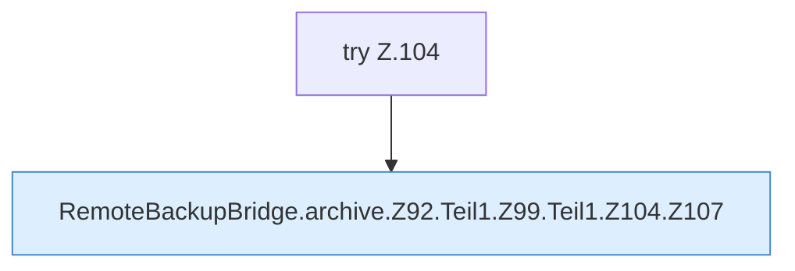

[[00 Start]] › [[Backup]] › [[Backup-Bruecken]] › [[RemoteBackupBridge]] › [[RemoteBackupBridge.Teil1]] › [[RemoteBackupBridge.archive]] › [[RemoteBackupBridge.archive.Z92.Teil1.Z99.Teil1.Z104]]

# RemoteBackupBridge.archive.Z92.Teil1.Z99.Teil1.Z104



```knoten
try Z.104
  Zeile 104: Versuch. Der Fehlerpfad geht in catch.
RemoteBackupBridge.archive.Z92.Teil1.Z99.Teil1.Z104.Z107
  Der Ablauf geht in [[Glossar#Zeile|Zeile]] 107 weiter. Eine Ebene tiefer steht er genauer. Fortsetzung des Ablaufs ab Zeile 107.
```

> [!knoten]- Was die Blöcke tun
> - **try Z.104**: Zeile 104: Versuch. Der Fehlerpfad geht in catch.
> - **RemoteBackupBridge.archive.Z92.Teil1.Z99.Teil1.Z104.Z107**: Der Ablauf geht in [[Glossar#Zeile|Zeile]] 107 weiter. Eine Ebene tiefer steht er genauer. Fortsetzung des Ablaufs ab Zeile 107.

- Der Ablauf geht in [[Glossar#Zeile|Zeile]] 104 weiter. Eine Ebene tiefer steht er genauer.
- Fortsetzung von `RemoteBackupBridge.archive.Z92.Teil1.Z99.Teil1`.
