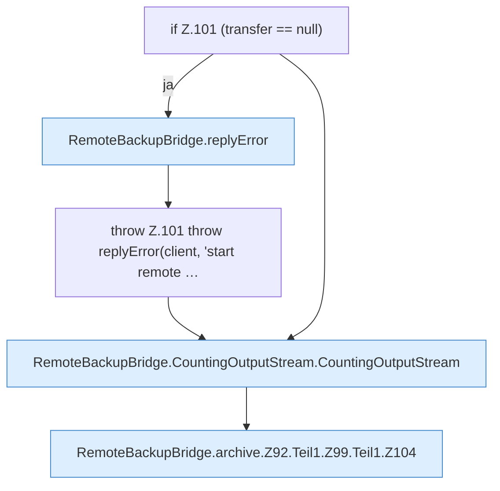

[[00 Start]] › [[Backup]] › [[Backup-Bruecken]] › [[RemoteBackupBridge]] › [[RemoteBackupBridge.Teil1]] › [[RemoteBackupBridge.archive]] › [[RemoteBackupBridge.archive.Z92.Teil1.Z99.Teil1]]

# RemoteBackupBridge.archive.Z92.Teil1.Z99.Teil1



```knoten
if Z.101 (transfer == null)
  Zeile 101: prüft `(transfer == null)`.
RemoteBackupBridge.replyError
  Antwortet `replyError`.
throw Z.101 throw replyError(client, 'start remote …
  Zeile 101: Abbruch `throw replyError(client, 'start remote …`.
RemoteBackupBridge.CountingOutputStream.CountingOutputStream
  `CountingOutputStream` in `RemoteBackupBridge.java`.
RemoteBackupBridge.archive.Z92.Teil1.Z99.Teil1.Z104
  Fortsetzung des Ablaufs ab Zeile 104.
```

- Fortsetzung von `RemoteBackupBridge.archive.Z92.Teil1.Z99`, Quellreihenfolge.
