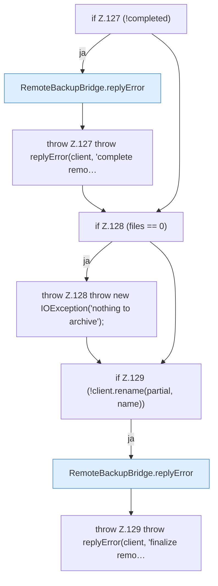

[[00 Start]] › [[Backup]] › [[Backup-Bruecken]] › [[RemoteBackupBridge]] › [[RemoteBackupBridge.Teil1]] › [[RemoteBackupBridge.archive]] › [[RemoteBackupBridge.archive.Z92.Teil1.Z99.Teil2]]

# RemoteBackupBridge.archive.Z92.Teil1.Z99.Teil2



```knoten
if Z.127 (!completed)
  Zeile 127: prüft `(!completed)`.
RemoteBackupBridge.replyError
  Die Sicherung über das Netz macht hier einen einzelnen Schritt. Eine Ebene tiefer steht er genauer. Antwortet `replyError`.
throw Z.127 throw replyError(client, 'complete remo…
  Zeile 127: Abbruch `throw replyError(client, 'complete remo…`.
if Z.128 (files == 0)
  Zeile 128: prüft `(files == 0)`.
throw Z.128 throw new IOException('nothing to archive');
  Zeile 128: Abbruch `throw new IOException('nothing to archive');`.
if Z.129 (!client.rename(partial, name))
  Zeile 129: prüft `(!client.rename(partial, name))`.
throw Z.129 throw replyError(client, 'finalize remo…
  Zeile 129: Abbruch `throw replyError(client, 'finalize remo…`.
```

> [!knoten]- Was die Blöcke tun
> - **if Z.127 (!completed)**: Zeile 127: prüft `(!completed)`.
> - **RemoteBackupBridge.replyError**: Die Sicherung über das Netz macht hier einen einzelnen Schritt. Eine Ebene tiefer steht er genauer. Antwortet `replyError`.
> - **throw Z.127 throw replyError(client, 'complete remo…**: Zeile 127: Abbruch `throw replyError(client, 'complete remo…`.
> - **if Z.128 (files == 0)**: Zeile 128: prüft `(files == 0)`.
> - **throw Z.128 throw new IOException('nothing to archive');**: Zeile 128: Abbruch `throw new IOException('nothing to archive');`.
> - **if Z.129 (!client.rename(partial, name))**: Zeile 129: prüft `(!client.rename(partial, name))`.
> - **throw Z.129 throw replyError(client, 'finalize remo…**: Zeile 129: Abbruch `throw replyError(client, 'finalize remo…`.

- Ein weiterer Abschnitt derselben Übersicht.
- Fortsetzung von `RemoteBackupBridge.archive.Z92.Teil1.Z99`.
