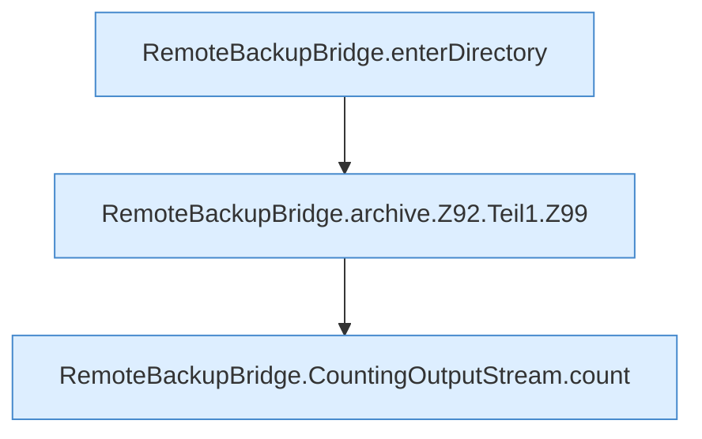

[[00 Start]] › [[Backup]] › [[Backup-Bruecken]] › [[RemoteBackupBridge]] › [[RemoteBackupBridge.Teil1]] › [[RemoteBackupBridge.archive]] › [[RemoteBackupBridge.archive.Z92.Teil1]]

# RemoteBackupBridge.archive.Z92.Teil1



```knoten
RemoteBackupBridge.enterDirectory
  Die Sicherung über das Netz macht hier einen einzelnen Schritt. Eine Ebene tiefer steht er genauer. Wechselt hinein `enterDirectory`. Ruft `enterBaseDirectory`, `replyError`.
RemoteBackupBridge.archive.Z92.Teil1.Z99
  Der Ablauf geht in [[Glossar#Zeile|Zeile]] 99 weiter. Eine Ebene tiefer steht er genauer. Fortsetzung des Ablaufs ab Zeile 99.
RemoteBackupBridge.CountingOutputStream.count
  Die Sicherung über das Netz zählt das. Zählt `count`.
```

> [!knoten]- Was die Blöcke tun
> - **RemoteBackupBridge.enterDirectory**: Die Sicherung über das Netz macht hier einen einzelnen Schritt. Eine Ebene tiefer steht er genauer. Wechselt hinein `enterDirectory`. Ruft `enterBaseDirectory`, `replyError`.
> - **RemoteBackupBridge.archive.Z92.Teil1.Z99**: Der Ablauf geht in [[Glossar#Zeile|Zeile]] 99 weiter. Eine Ebene tiefer steht er genauer. Fortsetzung des Ablaufs ab Zeile 99.
> - **RemoteBackupBridge.CountingOutputStream.count**: Die Sicherung über das Netz zählt das. Zählt `count`.

- Ein weiterer Abschnitt derselben Übersicht.
- Fortsetzung von `RemoteBackupBridge.archive.Z92`.
