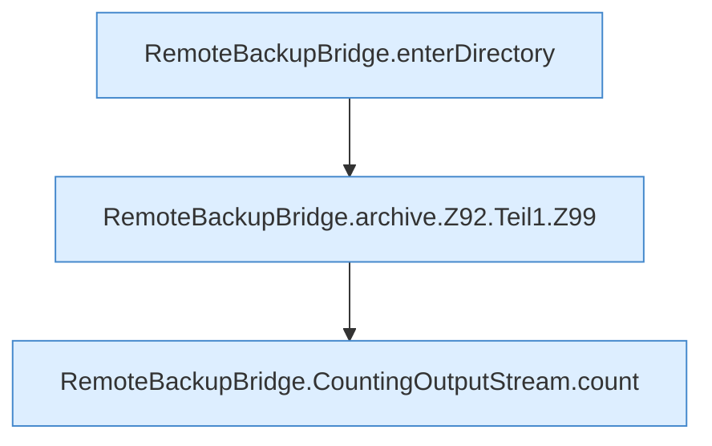

[[00 Start]] › [[Backup]] › [[Backup-Bruecken]] › [[RemoteBackupBridge]] › [[RemoteBackupBridge.Teil1]] › [[RemoteBackupBridge.archive]] › [[RemoteBackupBridge.archive.Z92.Teil1]]

# RemoteBackupBridge.archive.Z92.Teil1



```knoten
RemoteBackupBridge.enterDirectory
  Wechselt hinein `enterDirectory`. Ruft `enterBaseDirectory`, `replyError`.
RemoteBackupBridge.archive.Z92.Teil1.Z99
  Fortsetzung des Ablaufs ab Zeile 99.
RemoteBackupBridge.CountingOutputStream.count
  Zählt `count`.
```

- Fortsetzung von `RemoteBackupBridge.archive.Z92`, Quellreihenfolge.
