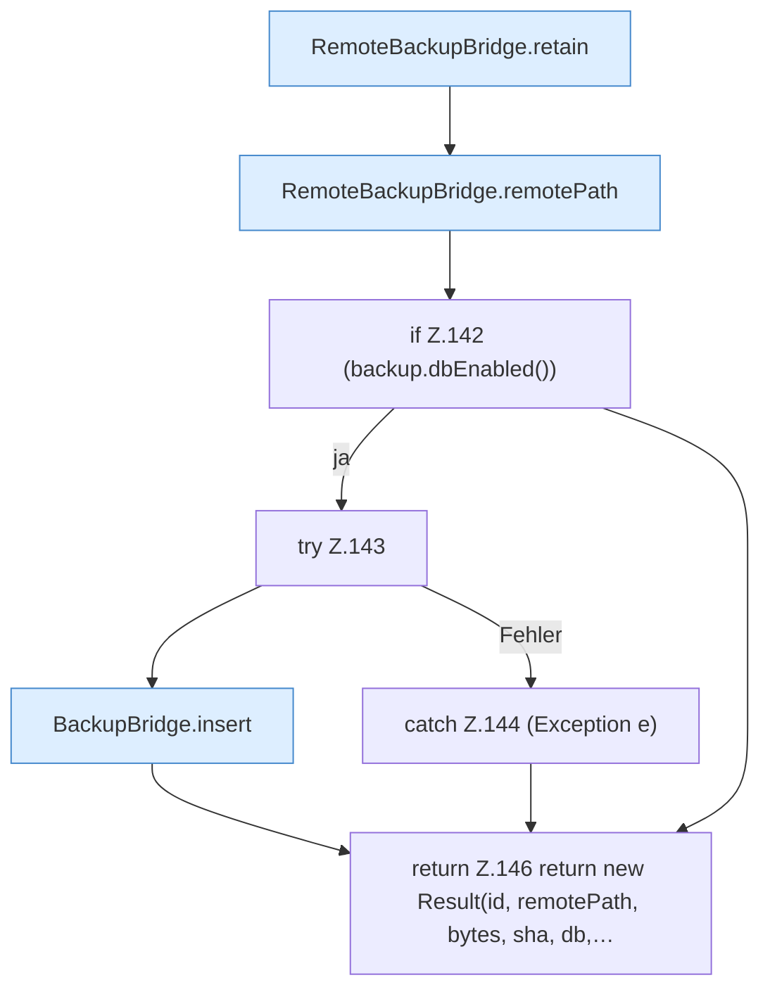

[[00 Start]] › [[Backup]] › [[Backup-Bruecken]] › [[RemoteBackupBridge]] › [[RemoteBackupBridge.Teil1]] › [[RemoteBackupBridge.archive]] › [[RemoteBackupBridge.archive.Z92.Teil2]]

# RemoteBackupBridge.archive.Z92.Teil2



```knoten
RemoteBackupBridge.retain
  Die Sicherung über das Netz macht hier einen einzelnen Schritt. Eine Ebene tiefer steht er genauer. Behält die letzten Stücke `retain`. Ruft `named`, `replyError`.
RemoteBackupBridge.remotePath
  Die Sicherung über das Netz kümmert sich um den Pfad. `remotePath` in `RemoteBackupBridge.java`.
if Z.142 (backup.dbEnabled())
  Zeile 142: prüft `(backup.dbEnabled())`.
try Z.143
  Zeile 143: Versuch. Der Fehlerpfad geht in catch.
BackupBridge.insert
  Die Sicherung auf diesem Rechner macht hier einen einzelnen Schritt. Eine Ebene tiefer steht er genauer. Fügt ein `insert`. Ruft `connect`, `table`, `ensureTable`.
catch Z.144 (Exception e)
  Zeile 144: fängt (Exception e).
return Z.146 return new Result(id, remotePath, bytes, sha, db,…
  Zeile 146: Rückgabe `return new Result(id, remotePath, bytes, sha, db,…`.
```

> [!knoten]- Was die Blöcke tun
> - **RemoteBackupBridge.retain**: Die Sicherung über das Netz macht hier einen einzelnen Schritt. Eine Ebene tiefer steht er genauer. Behält die letzten Stücke `retain`. Ruft `named`, `replyError`.
> - **RemoteBackupBridge.remotePath**: Die Sicherung über das Netz kümmert sich um den Pfad. `remotePath` in `RemoteBackupBridge.java`.
> - **if Z.142 (backup.dbEnabled())**: Zeile 142: prüft `(backup.dbEnabled())`.
> - **try Z.143**: Zeile 143: Versuch. Der Fehlerpfad geht in catch.
> - **BackupBridge.insert**: Die Sicherung auf diesem Rechner macht hier einen einzelnen Schritt. Eine Ebene tiefer steht er genauer. Fügt ein `insert`. Ruft `connect`, `table`, `ensureTable`.
> - **catch Z.144 (Exception e)**: Zeile 144: fängt (Exception e).
> - **return Z.146 return new Result(id, remotePath, bytes, sha, db,…**: Zeile 146: Rückgabe `return new Result(id, remotePath, bytes, sha, db,…`.

- Ein weiterer Abschnitt derselben Übersicht.
- Fortsetzung von `RemoteBackupBridge.archive.Z92`.
