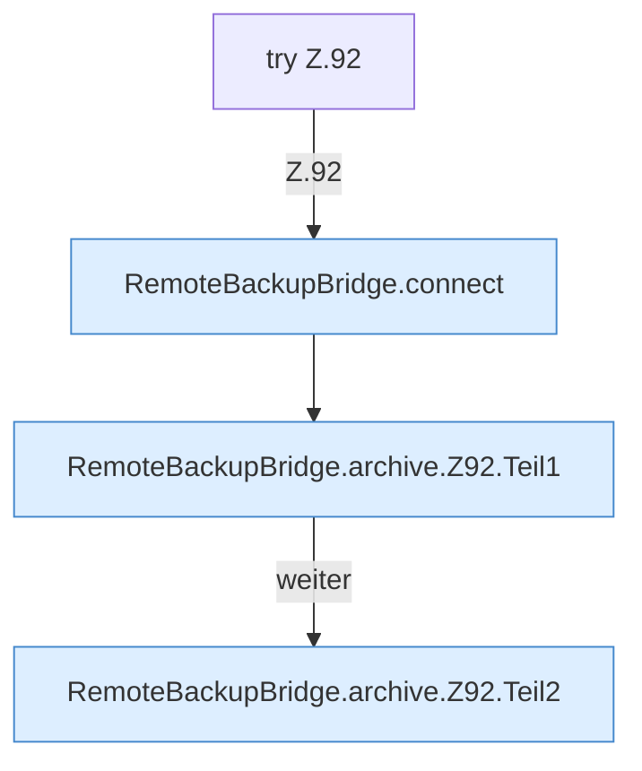

[[00 Start]] › [[Backup]] › [[Backup-Bruecken]] › [[RemoteBackupBridge]] › [[RemoteBackupBridge.Teil1]] › [[RemoteBackupBridge.archive]] › [[RemoteBackupBridge.archive.Z92]]

# RemoteBackupBridge.archive.Z92

- Fortsetzung von `RemoteBackupBridge.archive`, Quellreihenfolge.
