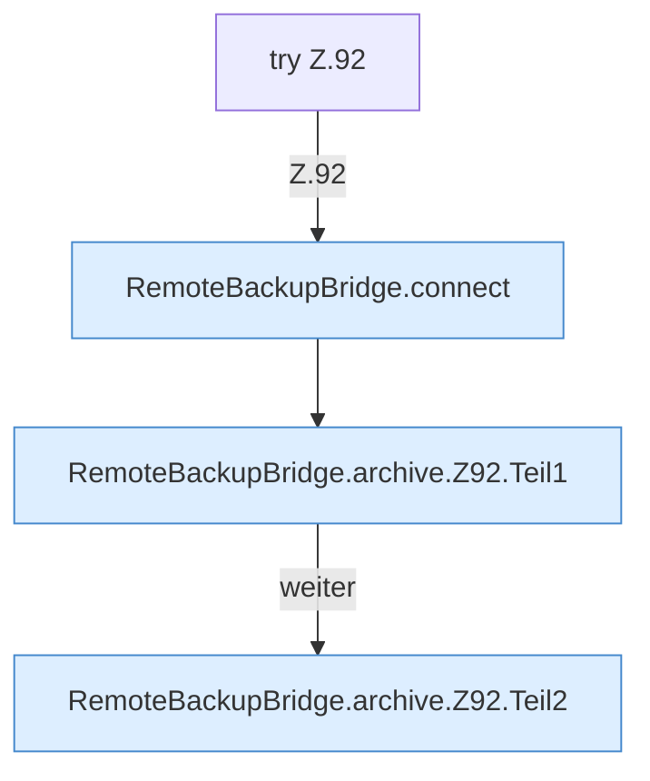

[[00 Start]] › [[Backup]] › [[Backup-Bruecken]] › [[RemoteBackupBridge]] › [[RemoteBackupBridge.Teil1]] › [[RemoteBackupBridge.archive]] › [[RemoteBackupBridge.archive.Z92]]

# RemoteBackupBridge.archive.Z92



```knoten
try Z.92
  Zeile 92: Versuch. Der Fehlerpfad geht in catch.
RemoteBackupBridge.connect
  Die Sicherung über das Netz macht hier einen einzelnen Schritt. Eine Ebene tiefer steht er genauer. Verbindet `connect`. Ruft `validateCredentials`, `openFtps`, `openFtp`.
RemoteBackupBridge.archive.Z92.Teil1
  Ein weiterer Abschnitt derselben Übersicht. Abschnitt 1 dieses Ablaufs, in Quellreihenfolge.
RemoteBackupBridge.archive.Z92.Teil2
  Ein weiterer Abschnitt derselben Übersicht. Abschnitt 2 dieses Ablaufs, in Quellreihenfolge.
```

> [!knoten]- Was die Blöcke tun
> - **try Z.92**: Zeile 92: Versuch. Der Fehlerpfad geht in catch.
> - **RemoteBackupBridge.connect**: Die Sicherung über das Netz macht hier einen einzelnen Schritt. Eine Ebene tiefer steht er genauer. Verbindet `connect`. Ruft `validateCredentials`, `openFtps`, `openFtp`.
> - **RemoteBackupBridge.archive.Z92.Teil1**: Ein weiterer Abschnitt derselben Übersicht. Abschnitt 1 dieses Ablaufs, in Quellreihenfolge.
> - **RemoteBackupBridge.archive.Z92.Teil2**: Ein weiterer Abschnitt derselben Übersicht. Abschnitt 2 dieses Ablaufs, in Quellreihenfolge.

- Der Ablauf geht in [[Glossar#Zeile|Zeile]] 92 weiter. Eine Ebene tiefer steht er genauer.
- Fortsetzung von `RemoteBackupBridge.archive`.
