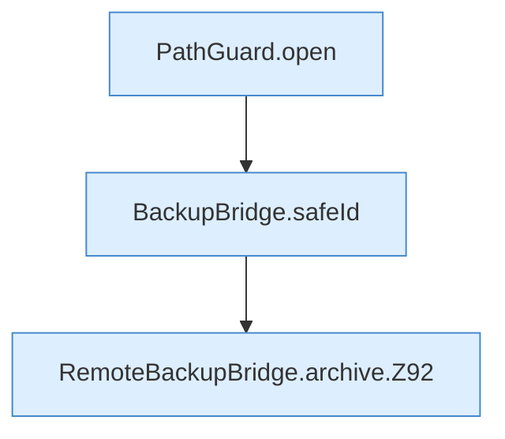

[[00 Start]] › [[Backup]] › [[Backup-Bruecken]] › [[RemoteBackupBridge]] › [[RemoteBackupBridge.Teil1]] › [[RemoteBackupBridge.archive]]

# RemoteBackupBridge.archive

`RemoteBackupBridge.archive(Path work, BackupBridge.Spec backup, Settings settings, String username, String password, String serverId)` [src/main/java/de/aichele/childlauncher/RemoteBackupBridge.java:83–148](https://github.com/Sciddie/minecraft-serverhoster-plugin/blob/95b02b953b0b4c23673e900e021a7c3c844aa37d/src/main/java/de/aichele/childlauncher/RemoteBackupBridge.java#L83-L148)

- `archive` in `src/main/java/de/aichele/childlauncher/RemoteBackupBridge.java`
