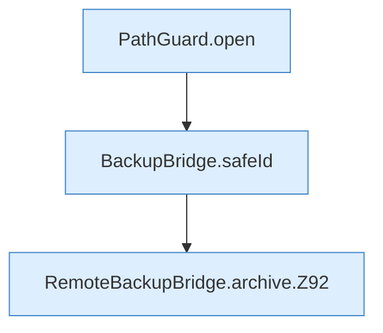

[[00 Start]] › [[Backup]] › [[Backup-Bruecken]] › [[RemoteBackupBridge]] › [[RemoteBackupBridge.Teil1]] › [[RemoteBackupBridge.archive]]

# RemoteBackupBridge.archive

`RemoteBackupBridge.archive(Path work, BackupBridge.Spec backup, Settings settings, String username, String password, String serverId)` [src/main/java/de/aichele/childlauncher/RemoteBackupBridge.java:83–148](https://github.com/Sciddie/minecraft-serverhoster-plugin/blob/95b02b953b0b4c23673e900e021a7c3c844aa37d/src/main/java/de/aichele/childlauncher/RemoteBackupBridge.java#L83-L148)



```knoten
PathGuard.open
  Dieser Teil öffnet das. Öffnet `open`. Ruft `PathGuard`.
BackupBridge.safeId
  Die Sicherung auf diesem Rechner kümmert sich um die Kennung. Prüft die Pfadgrenze `safeId`.
RemoteBackupBridge.archive.Z92
  Der Ablauf geht in [[Glossar#Zeile|Zeile]] 92 weiter. Eine Ebene tiefer steht er genauer. Fortsetzung des Ablaufs ab Zeile 92.
```

> [!knoten]- Was die Blöcke tun
> - **PathGuard.open**: Dieser Teil öffnet das. Öffnet `open`. Ruft `PathGuard`.
> - **BackupBridge.safeId**: Die Sicherung auf diesem Rechner kümmert sich um die Kennung. Prüft die Pfadgrenze `safeId`.
> - **RemoteBackupBridge.archive.Z92**: Der Ablauf geht in [[Glossar#Zeile|Zeile]] 92 weiter. Eine Ebene tiefer steht er genauer. Fortsetzung des Ablaufs ab Zeile 92.

- Die Sicherung über das Netz macht hier einen einzelnen Schritt. Eine Ebene tiefer steht er genauer.
- `archive` in `src/main/java/de/aichele/childlauncher/RemoteBackupBridge.java`
