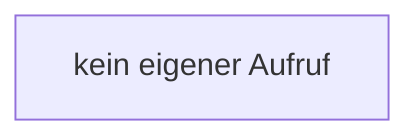

[[00 Start]] › [[Backup]] › [[Backup-Bruecken]] › [[RemoteBackupBridge]] › [[RemoteBackupBridge.Teil2]] › [[RemoteBackupBridge.configure]]

# RemoteBackupBridge.configure

`RemoteBackupBridge.configure(FTPClient client)` [src/main/java/de/aichele/childlauncher/RemoteBackupBridge.java:250–255](https://github.com/Sciddie/minecraft-serverhoster-plugin/blob/95b02b953b0b4c23673e900e021a7c3c844aa37d/src/main/java/de/aichele/childlauncher/RemoteBackupBridge.java#L250-L255)

- `configure` in `src/main/java/de/aichele/childlauncher/RemoteBackupBridge.java`
