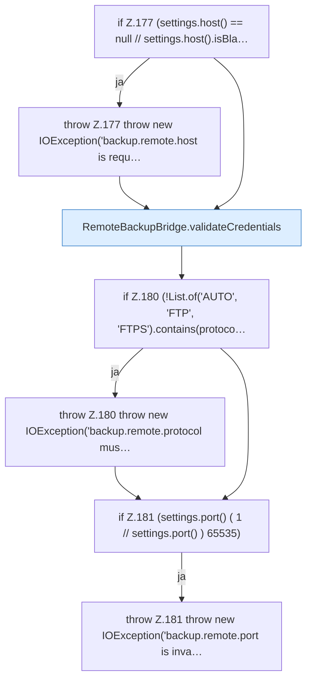

[[00 Start]] › [[Backup]] › [[Backup-Bruecken]] › [[RemoteBackupBridge]] › [[RemoteBackupBridge.Teil2]] › [[RemoteBackupBridge.connect]] › [[RemoteBackupBridge.connect.Teil1]]

# RemoteBackupBridge.connect.Teil1

- Fortsetzung von `RemoteBackupBridge.connect`, Quellreihenfolge.
