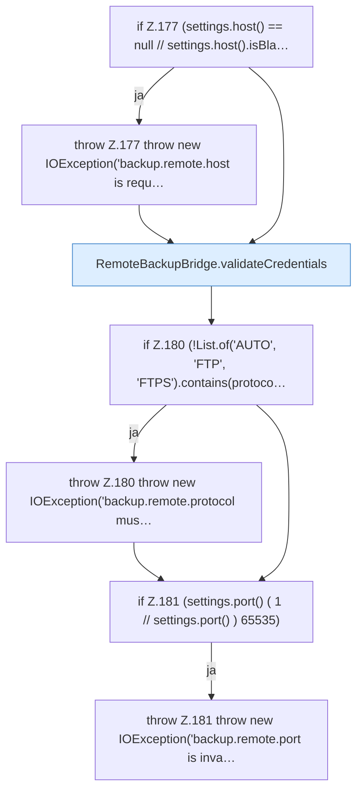

[[00 Start]] › [[Backup]] › [[Backup-Bruecken]] › [[RemoteBackupBridge]] › [[RemoteBackupBridge.Teil2]] › [[RemoteBackupBridge.connect]] › [[RemoteBackupBridge.connect.Teil1]]

# RemoteBackupBridge.connect.Teil1



```knoten
if Z.177 (settings.host() == null // settings.host().isBla…
  Zeile 177: prüft `(settings.host() == null // settings.host().isBla…`.
throw Z.177 throw new IOException('backup.remote.host is requ…
  Zeile 177: Abbruch `throw new IOException('backup.remote.host is requ…`.
RemoteBackupBridge.validateCredentials
  Die Sicherung über das Netz prüft die Zugangsdaten. Prüft `validateCredentials`. Ruft `hasControlCharacter`.
if Z.180 (!List.of('AUTO', 'FTP', 'FTPS').contains(protoco…
  Zeile 180: prüft `(!List.of('AUTO', 'FTP', 'FTPS').contains(protoco…`.
throw Z.180 throw new IOException('backup.remote.protocol mus…
  Zeile 180: Abbruch `throw new IOException('backup.remote.protocol mus…`.
if Z.181 (settings.port() ( 1 // settings.port() ) 65535)
  Zeile 181: prüft `(settings.port() ( 1 // settings.port() ) 65535)`.
throw Z.181 throw new IOException('backup.remote.port is inva…
  Zeile 181: Abbruch `throw new IOException('backup.remote.port is inva…`.
```

> [!knoten]- Was die Blöcke tun
> - **if Z.177 (settings.host() == null // settings.host().isBla…**: Zeile 177: prüft `(settings.host() == null // settings.host().isBla…`.
> - **throw Z.177 throw new IOException('backup.remote.host is requ…**: Zeile 177: Abbruch `throw new IOException('backup.remote.host is requ…`.
> - **RemoteBackupBridge.validateCredentials**: Die Sicherung über das Netz prüft die Zugangsdaten. Prüft `validateCredentials`. Ruft `hasControlCharacter`.
> - **if Z.180 (!List.of('AUTO', 'FTP', 'FTPS').contains(protoco…**: Zeile 180: prüft `(!List.of('AUTO', 'FTP', 'FTPS').contains(protoco…`.
> - **throw Z.180 throw new IOException('backup.remote.protocol mus…**: Zeile 180: Abbruch `throw new IOException('backup.remote.protocol mus…`.
> - **if Z.181 (settings.port() ( 1 // settings.port() ) 65535)**: Zeile 181: prüft `(settings.port() ( 1 // settings.port() ) 65535)`.
> - **throw Z.181 throw new IOException('backup.remote.port is inva…**: Zeile 181: Abbruch `throw new IOException('backup.remote.port is inva…`.

- Ein weiterer Abschnitt derselben Übersicht.
- Fortsetzung von `RemoteBackupBridge.connect`.
