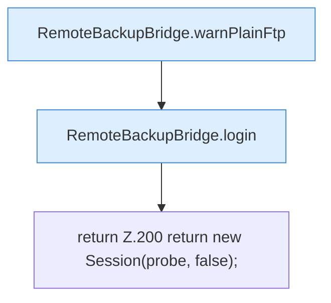

[[00 Start]] › [[Backup]] › [[Backup-Bruecken]] › [[RemoteBackupBridge]] › [[RemoteBackupBridge.Teil2]] › [[RemoteBackupBridge.connect]] › [[RemoteBackupBridge.connect.Teil3.Z188.Teil2]]

# RemoteBackupBridge.connect.Teil3.Z188.Teil2



```knoten
RemoteBackupBridge.warnPlainFtp
  Die Sicherung über das Netz warnt vor die Übertragung. Warnt `warnPlainFtp`.
RemoteBackupBridge.login
  Die Sicherung über das Netz meldet an bei das. Meldet an `login`. Ruft `replyError`.
return Z.200 return new Session(probe, false);
  Zeile 200: Rückgabe `return new Session(probe, false);`.
```

> [!knoten]- Was die Blöcke tun
> - **RemoteBackupBridge.warnPlainFtp**: Die Sicherung über das Netz warnt vor die Übertragung. Warnt `warnPlainFtp`.
> - **RemoteBackupBridge.login**: Die Sicherung über das Netz meldet an bei das. Meldet an `login`. Ruft `replyError`.
> - **return Z.200 return new Session(probe, false);**: Zeile 200: Rückgabe `return new Session(probe, false);`.

- Ein weiterer Abschnitt derselben Übersicht.
- Fortsetzung von `RemoteBackupBridge.connect.Teil3.Z188`.
