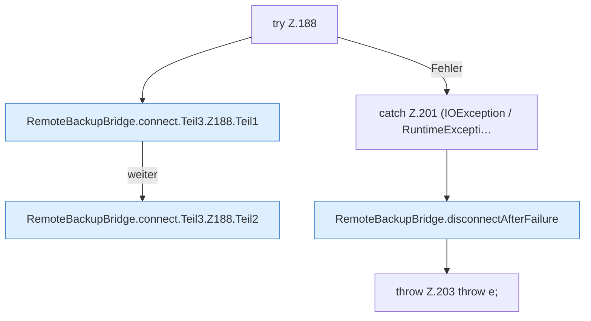

[[00 Start]] › [[Backup]] › [[Backup-Bruecken]] › [[RemoteBackupBridge]] › [[RemoteBackupBridge.Teil2]] › [[RemoteBackupBridge.connect]] › [[RemoteBackupBridge.connect.Teil3.Z188]]

# RemoteBackupBridge.connect.Teil3.Z188



```knoten
try Z.188
  Zeile 188: Versuch. Der Fehlerpfad geht in catch.
RemoteBackupBridge.connect.Teil3.Z188.Teil1
  Ein weiterer Abschnitt derselben Übersicht. Abschnitt 1 dieses Ablaufs, in Quellreihenfolge.
RemoteBackupBridge.connect.Teil3.Z188.Teil2
  Ein weiterer Abschnitt derselben Übersicht. Abschnitt 2 dieses Ablaufs, in Quellreihenfolge.
catch Z.201 (IOException / RuntimeExcepti…
  Zeile 201: fängt (IOException / RuntimeExcepti….
RemoteBackupBridge.disconnectAfterFailure
  Die Sicherung über das Netz macht hier einen einzelnen Schritt. Eine Ebene tiefer steht er genauer. Trennt `disconnectAfterFailure`. Ruft `disconnect`.
throw Z.203 throw e;
  Zeile 203: Abbruch `throw e;`.
```

> [!knoten]- Was die Blöcke tun
> - **try Z.188**: Zeile 188: Versuch. Der Fehlerpfad geht in catch.
> - **RemoteBackupBridge.connect.Teil3.Z188.Teil1**: Ein weiterer Abschnitt derselben Übersicht. Abschnitt 1 dieses Ablaufs, in Quellreihenfolge.
> - **RemoteBackupBridge.connect.Teil3.Z188.Teil2**: Ein weiterer Abschnitt derselben Übersicht. Abschnitt 2 dieses Ablaufs, in Quellreihenfolge.
> - **catch Z.201 (IOException / RuntimeExcepti…**: Zeile 201: fängt (IOException / RuntimeExcepti….
> - **RemoteBackupBridge.disconnectAfterFailure**: Die Sicherung über das Netz macht hier einen einzelnen Schritt. Eine Ebene tiefer steht er genauer. Trennt `disconnectAfterFailure`. Ruft `disconnect`.
> - **throw Z.203 throw e;**: Zeile 203: Abbruch `throw e;`.

- Der Ablauf geht in [[Glossar#Zeile|Zeile]] 188 weiter. Eine Ebene tiefer steht er genauer.
- Fortsetzung von `RemoteBackupBridge.connect.Teil3`.
