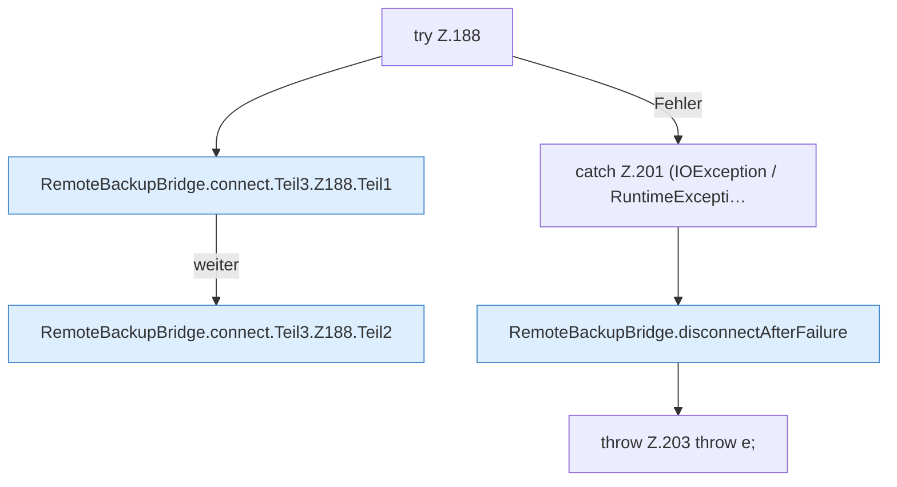

[[00 Start]] › [[Backup]] › [[Backup-Bruecken]] › [[RemoteBackupBridge]] › [[RemoteBackupBridge.Teil2]] › [[RemoteBackupBridge.connect]] › [[RemoteBackupBridge.connect.Teil3.Z188]]

# RemoteBackupBridge.connect.Teil3.Z188

- Fortsetzung von `RemoteBackupBridge.connect.Teil3`, Quellreihenfolge.
