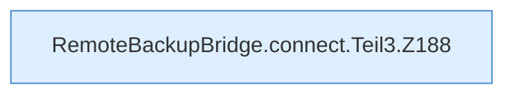

[[00 Start]] › [[Backup]] › [[Backup-Bruecken]] › [[RemoteBackupBridge]] › [[RemoteBackupBridge.Teil2]] › [[RemoteBackupBridge.connect]] › [[RemoteBackupBridge.connect.Teil3]]

# RemoteBackupBridge.connect.Teil3



```knoten
RemoteBackupBridge.connect.Teil3.Z188
  Der Ablauf geht in [[Glossar#Zeile|Zeile]] 188 weiter. Eine Ebene tiefer steht er genauer. Fortsetzung des Ablaufs ab Zeile 188.
```

> [!knoten]- Was die Blöcke tun
> - **RemoteBackupBridge.connect.Teil3.Z188**: Der Ablauf geht in [[Glossar#Zeile|Zeile]] 188 weiter. Eine Ebene tiefer steht er genauer. Fortsetzung des Ablaufs ab Zeile 188.

- Ein weiterer Abschnitt derselben Übersicht.
- Fortsetzung von `RemoteBackupBridge.connect`.
