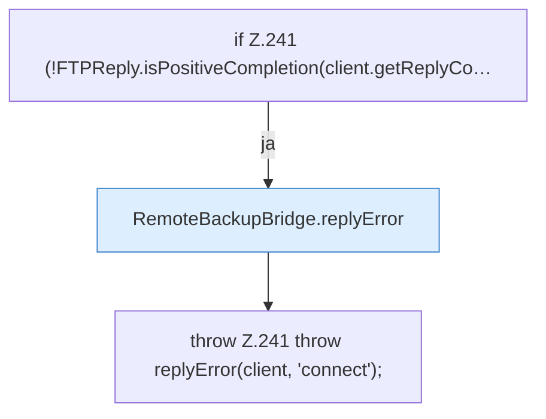

[[00 Start]] › [[Backup]] › [[Backup-Bruecken]] › [[RemoteBackupBridge]] › [[RemoteBackupBridge.Teil2]] › [[RemoteBackupBridge.connectControl]]

# RemoteBackupBridge.connectControl

`RemoteBackupBridge.connectControl(FTPClient client, Settings settings)` [src/main/java/de/aichele/childlauncher/RemoteBackupBridge.java:239–242](https://github.com/Sciddie/minecraft-serverhoster-plugin/blob/95b02b953b0b4c23673e900e021a7c3c844aa37d/src/main/java/de/aichele/childlauncher/RemoteBackupBridge.java#L239-L242)

- `connectControl` in `src/main/java/de/aichele/childlauncher/RemoteBackupBridge.java`
