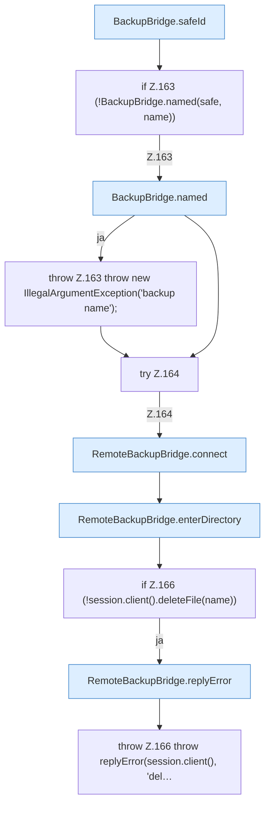

[[00 Start]] › [[Backup]] › [[Backup-Bruecken]] › [[RemoteBackupBridge]] › [[RemoteBackupBridge.Teil1]] › [[RemoteBackupBridge.delete]]

# RemoteBackupBridge.delete

`RemoteBackupBridge.delete(Settings settings, String username, String password, String serverId, String name)` [src/main/java/de/aichele/childlauncher/RemoteBackupBridge.java:160–168](https://github.com/Sciddie/minecraft-serverhoster-plugin/blob/95b02b953b0b4c23673e900e021a7c3c844aa37d/src/main/java/de/aichele/childlauncher/RemoteBackupBridge.java#L160-L168)



```knoten
BackupBridge.safeId
  Die Sicherung auf diesem Rechner kümmert sich um die Kennung. Prüft die Pfadgrenze `safeId`.
if Z.163 (!BackupBridge.named(safe, name))
  Zeile 163: prüft `(!BackupBridge.named(safe, name))`.
BackupBridge.named
  Die Sicherung auf diesem Rechner macht hier einen einzelnen Schritt. Eine Ebene tiefer steht er genauer. `named` in `BackupBridge.java`.
throw Z.163 throw new IllegalArgumentException('backup name');
  Zeile 163: Abbruch `throw new IllegalArgumentException('backup name');`.
try Z.164
  Zeile 164: Versuch. Der Fehlerpfad geht in catch.
RemoteBackupBridge.connect
  Die Sicherung über das Netz macht hier einen einzelnen Schritt. Eine Ebene tiefer steht er genauer. Verbindet `connect`. Ruft `validateCredentials`, `openFtps`, `openFtp`.
RemoteBackupBridge.enterDirectory
  Die Sicherung über das Netz macht hier einen einzelnen Schritt. Eine Ebene tiefer steht er genauer. Wechselt hinein `enterDirectory`. Ruft `enterBaseDirectory`, `replyError`.
if Z.166 (!session.client().deleteFile(name))
  Zeile 166: prüft `(!session.client().deleteFile(name))`.
RemoteBackupBridge.replyError
  Die Sicherung über das Netz macht hier einen einzelnen Schritt. Eine Ebene tiefer steht er genauer. Antwortet `replyError`.
throw Z.166 throw replyError(session.client(), 'del…
  Zeile 166: Abbruch `throw replyError(session.client(), 'del…`.
```

> [!knoten]- Was die Blöcke tun
> - **BackupBridge.safeId**: Die Sicherung auf diesem Rechner kümmert sich um die Kennung. Prüft die Pfadgrenze `safeId`.
> - **if Z.163 (!BackupBridge.named(safe, name))**: Zeile 163: prüft `(!BackupBridge.named(safe, name))`.
> - **BackupBridge.named**: Die Sicherung auf diesem Rechner macht hier einen einzelnen Schritt. Eine Ebene tiefer steht er genauer. `named` in `BackupBridge.java`.
> - **throw Z.163 throw new IllegalArgumentException('backup name');**: Zeile 163: Abbruch `throw new IllegalArgumentException('backup name');`.
> - **try Z.164**: Zeile 164: Versuch. Der Fehlerpfad geht in catch.
> - **RemoteBackupBridge.connect**: Die Sicherung über das Netz macht hier einen einzelnen Schritt. Eine Ebene tiefer steht er genauer. Verbindet `connect`. Ruft `validateCredentials`, `openFtps`, `openFtp`.
> - **RemoteBackupBridge.enterDirectory**: Die Sicherung über das Netz macht hier einen einzelnen Schritt. Eine Ebene tiefer steht er genauer. Wechselt hinein `enterDirectory`. Ruft `enterBaseDirectory`, `replyError`.
> - **if Z.166 (!session.client().deleteFile(name))**: Zeile 166: prüft `(!session.client().deleteFile(name))`.
> - **RemoteBackupBridge.replyError**: Die Sicherung über das Netz macht hier einen einzelnen Schritt. Eine Ebene tiefer steht er genauer. Antwortet `replyError`.
> - **throw Z.166 throw replyError(session.client(), 'del…**: Zeile 166: Abbruch `throw replyError(session.client(), 'del…`.

- Die Sicherung über das Netz löscht das.
- `delete` in `src/main/java/de/aichele/childlauncher/RemoteBackupBridge.java`
