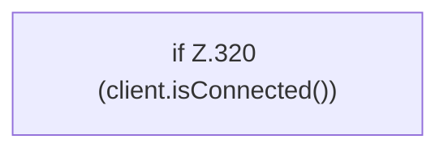

[[00 Start]] › [[Backup]] › [[Backup-Bruecken]] › [[RemoteBackupBridge]] › [[RemoteBackupBridge.Teil3]] › [[RemoteBackupBridge.disconnect]]

# RemoteBackupBridge.disconnect

`RemoteBackupBridge.disconnect(FTPClient client)` [src/main/java/de/aichele/childlauncher/RemoteBackupBridge.java:319–321](https://github.com/Sciddie/minecraft-serverhoster-plugin/blob/95b02b953b0b4c23673e900e021a7c3c844aa37d/src/main/java/de/aichele/childlauncher/RemoteBackupBridge.java#L319-L321)



```knoten
if Z.320 (client.isConnected())
  Zeile 320: prüft `(client.isConnected())`.
```

> [!knoten]- Was die Blöcke tun
> - **if Z.320 (client.isConnected())**: Zeile 320: prüft `(client.isConnected())`.

- Die Sicherung über das Netz macht hier einen einzelnen Schritt. Eine Ebene tiefer steht er genauer.
- `disconnect` in `src/main/java/de/aichele/childlauncher/RemoteBackupBridge.java`
