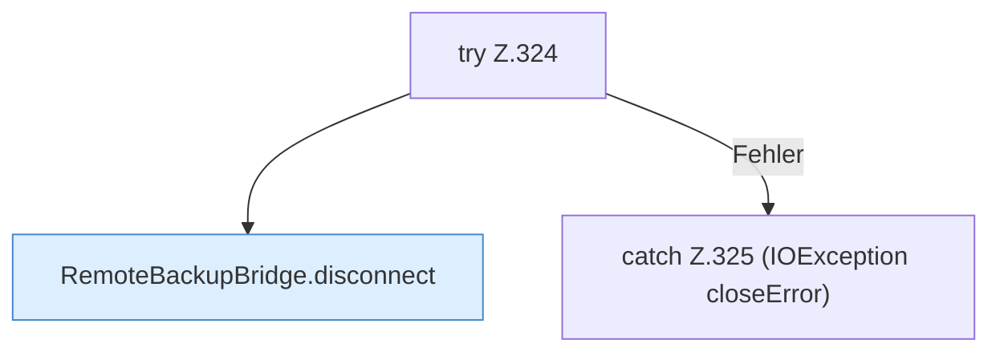

[[00 Start]] › [[Backup]] › [[Backup-Bruecken]] › [[RemoteBackupBridge]] › [[RemoteBackupBridge.Teil3]] › [[RemoteBackupBridge.disconnectAfterFailure]]

# RemoteBackupBridge.disconnectAfterFailure

`RemoteBackupBridge.disconnectAfterFailure(FTPClient client, Exception failure)` [src/main/java/de/aichele/childlauncher/RemoteBackupBridge.java:323–326](https://github.com/Sciddie/minecraft-serverhoster-plugin/blob/95b02b953b0b4c23673e900e021a7c3c844aa37d/src/main/java/de/aichele/childlauncher/RemoteBackupBridge.java#L323-L326)

- `disconnectAfterFailure` in `src/main/java/de/aichele/childlauncher/RemoteBackupBridge.java`
