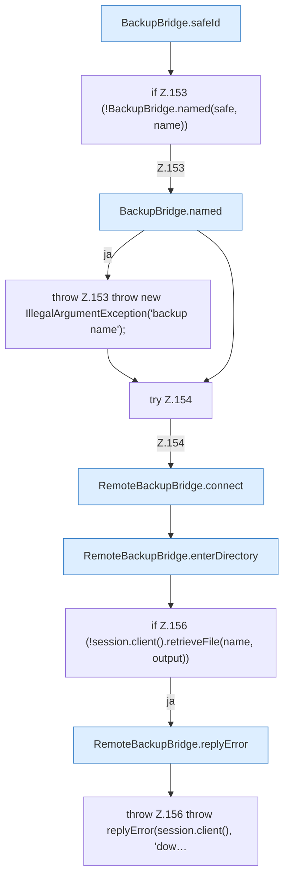

[[00 Start]] › [[Backup]] › [[Backup-Bruecken]] › [[RemoteBackupBridge]] › [[RemoteBackupBridge.Teil1]] › [[RemoteBackupBridge.download]]

# RemoteBackupBridge.download

`RemoteBackupBridge.download(Settings settings, String username, String password, String serverId, String name, OutputStream output)` [src/main/java/de/aichele/childlauncher/RemoteBackupBridge.java:150–158](https://github.com/Sciddie/minecraft-serverhoster-plugin/blob/95b02b953b0b4c23673e900e021a7c3c844aa37d/src/main/java/de/aichele/childlauncher/RemoteBackupBridge.java#L150-L158)



```knoten
BackupBridge.safeId
  Prüft die Pfadgrenze `safeId`.
if Z.153 (!BackupBridge.named(safe, name))
  Zeile 153: prüft `(!BackupBridge.named(safe, name))`.
BackupBridge.named
  `named` in `BackupBridge.java`.
throw Z.153 throw new IllegalArgumentException('backup name');
  Zeile 153: Abbruch `throw new IllegalArgumentException('backup name');`.
try Z.154
  Zeile 154: Versuch. Der Fehlerpfad geht in catch.
RemoteBackupBridge.connect
  Verbindet `connect`. Ruft `validateCredentials`, `openFtps`, `openFtp`.
RemoteBackupBridge.enterDirectory
  Wechselt hinein `enterDirectory`. Ruft `enterBaseDirectory`, `replyError`.
if Z.156 (!session.client().retrieveFile(name, output))
  Zeile 156: prüft `(!session.client().retrieveFile(name, output))`.
RemoteBackupBridge.replyError
  Antwortet `replyError`.
throw Z.156 throw replyError(session.client(), 'dow…
  Zeile 156: Abbruch `throw replyError(session.client(), 'dow…`.
```

- `download` in `src/main/java/de/aichele/childlauncher/RemoteBackupBridge.java`
